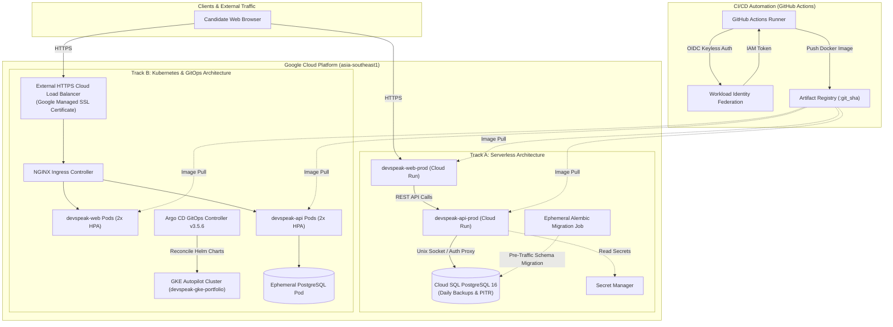

# DevSpeak AI — AI English Interview Coach for IT & DevOps Professionals

[](https://github.com/nguyenlpn2015/DevSpeak-AI/actions/workflows/ci.yml)
[](https://github.com/nguyenlpn2015/DevSpeak-AI/releases/tag/v1.0.2)
[](https://devspeak-web-prod-ygz4gsol4q-as.a.run.app)
[](https://devspeak.endpoints.project-12679df0-893b-4260-924.cloud.goog/)
[](LICENSE)
[](https://www.python.org/)
[](https://fastapi.tiangolo.com/)
[-black.svg)](https://nextjs.org/)
[](https://argo-cd.readthedocs.io/)
[](https://www.terraform.io/)

> **DevSpeak AI** is an enterprise-grade, bilingual (English / Vietnamese) technical interview coaching platform and cloud platform showcase. Built specifically for Software Engineers, DevOps/SREs, and Cloud Architects preparing for international technical interviews, incident response debriefs, and system design defenses.

---

## ⚡ 30-Second Executive Summary

| Question | Answer |
| :--- | :--- |
| **What is DevSpeak AI?** | A specialized web platform combining a 3-zone practice studio, real-time voice input, STAR framework structuring, and multidimensional AI scoring for IT professionals. |
| **Who is it for?** | Software Engineers, DevOps Engineers, SREs, Cloud Architects, and tech professionals interviewing with global tech companies in English. |
| **What problem does it solve?** | Bridges the gap between deep technical competency and articulate English expression—preventing candidates from failing interviews due to unstructured answers, missing keywords, or panic during deep-dive probing. |
| **What makes it technically unique?** | Demonstrates **dual cloud architectures** (Serverless containers on Cloud Run vs Cloud-Native GitOps on GKE Autopilot), **keyless Workload Identity Federation (WIF)**, decoupled DB migrations, and a privacy-first **deterministic mock evaluation engine** that eliminates external API costs. |
| **How can I try it right now?** | Explore our live production deployments on **[GCP GKE Autopilot (HTTPS)](https://devspeak.endpoints.project-12679df0-893b-4260-924.cloud.goog/)** or **[GCP Cloud Run](https://devspeak-web-prod-ygz4gsol4q-as.a.run.app)**, or spin up the local Docker stack in 60 seconds with `docker compose up -d`. |
| **Where is the architecture & code?** | Documented below with interactive Mermaid diagrams, modular code under `apps/` and `infra/`, and complete runbooks in `docs/`. |

---

## 🌐 Live Operational Environments (5 Environments across 2 Tracks)

The project runs across 5 distinct environments to demonstrate different stages of the modern software delivery lifecycle:

### Track A: Serverless & Containerized Architecture (Docker Compose + GCP Cloud Run)
| Environment | Service Component | Live Endpoint (URL) | Status | Architecture Notes |
| :--- | :--- | :--- | :--- | :--- |
| **1. Local Docker Compose** | Web (Port 3001)<br>API (Port 8000) | Web: [http://localhost:3001](http://localhost:3001)<br>API: [http://localhost:8000](http://localhost:8000)<br>Probe: [http://localhost:8000/readyz](http://localhost:8000/readyz) | 🟢 Healthy | Multi-stage Docker, PostgreSQL 16 Alpine, local health checks. |
| **2. GCP Cloud Run Staging** | Web Frontend<br>FastAPI Engine | Web: [https://devspeak-web-staging-ygz4gsol4q-as.a.run.app](https://devspeak-web-staging-ygz4gsol4q-as.a.run.app)<br>Probe: [https://devspeak-api-staging-ygz4gsol4q-as.a.run.app/readyz](https://devspeak-api-staging-ygz4gsol4q-as.a.run.app/readyz) | 🟢 Healthy | Continuous deployment via GitHub Actions on PR merge. Swagger UI enabled. |
| **3. GCP Cloud Run Production** | Web Frontend<br>FastAPI Engine | Web: [https://devspeak-web-prod-ygz4gsol4q-as.a.run.app](https://devspeak-web-prod-ygz4gsol4q-as.a.run.app)<br>Probe: [https://devspeak-api-prod-ygz4gsol4q-as.a.run.app/readyz](https://devspeak-api-prod-ygz4gsol4q-as.a.run.app/readyz) | 🟢 Healthy | Serverless scale-to-zero, Cloud SQL PostgreSQL via Auth Proxy, Swagger gated. |

### Track B: Kubernetes & GitOps Platform (kind + GKE Autopilot + Helm + Argo CD)
| Environment | Service Component | Live Endpoint (URL) | Status | Architecture Notes |
| :--- | :--- | :--- | :--- | :--- |
| **4. Local Kubernetes (kind)** | Helm + NGINX Ingress | Web: [http://localhost/](http://localhost/)<br>API: [http://localhost/api/v1/questions](http://localhost/api/v1/questions)<br>Probe: [http://localhost/readyz](http://localhost/readyz) | 🟢 Healthy | Local GitOps simulation using kind cluster `devspeak-local` with Ingress-NGINX. |
| **5. GCP GKE Autopilot (Prod)** | Helm + Argo CD + Google SSL | Web: [https://devspeak.endpoints.project-12679df0-893b-4260-924.cloud.goog/](https://devspeak.endpoints.project-12679df0-893b-4260-924.cloud.goog/)<br>Probe: [https://devspeak.endpoints.project-12679df0-893b-4260-924.cloud.goog/readyz](https://devspeak.endpoints.project-12679df0-893b-4260-924.cloud.goog/readyz) | 🟢 Healthy | Google Managed SSL Certificate, External HTTP(S) Cloud Load Balancer, Argo CD GitOps controller, HPA autoscaling (2 replicas each). |

> [!NOTE]
> **Deterministic Mock Evaluation & Privacy Policy:**
> To guarantee deterministic grading, zero ongoing LLM billing costs, and candidate privacy (no candidate voice transcripts or technical drafts sent to commercial AI vendors), public demos run using DevSpeak AI's **Deterministic Heuristic Mock Provider** by default. Live Google Gemini evaluation can be toggled in self-hosted instances with `AI_PROVIDER=gemini` and a `GEMINI_API_KEY`.
>
> **FinOps Transparency:**
> To manage Google Cloud Free Trial budgets responsibly, ephemeral GKE resources may be paused when no live interview demonstrations are scheduled. Track A (Serverless Cloud Run) remains permanently active due to its zero-cost scale-to-zero model.

---

## 🌟 Key Product Features

- **Flagship LinguaFlow Learning Studio**: Dark-neon user interface designed for extended engineering focus, complete with daily streak tracking, XP milestones, CEFR fluency benchmarks (B1 to C1), and 3D flashcards with native audio pronunciation.
- **Curated 26-Question IT & DevOps Catalog**: Real-world interview prompts spanning 7 core domains: Kubernetes architecture (`CrashLoopBackOff`, `OOMKilled`), CI/CD DevSecOps, Linux SRE internals, AWS cloud infrastructure, Docker hardening, distributed systems design, and STAR behavioral leadership.
- **3-Zone AI Interview Studio**: Single-viewport engineering cockpit with independently scrollable panels:
  - **Zone 1 (Session Navigation)**: Bounded 26-question catalog with status tags and search.
  - **Zone 2 (Response Workspace)**: Scenario prompt specs, live answer draft editor, character counter, and pinned action buttons.
  - **Zone 3 (Rubric & Coaching)**: 1-click technical keyword insertion, STAR framework generator, and benchmark 10/10 model answers.
- **Stateful Multi-Turn Interview Dialogue Engine**: Interactive conversational interview mode where the AI interviewer greets the candidate, evaluates opening answers, and probes technical edge cases across multiple rounds.
- **Voice Practice Mode (Web Speech API)**: Browser-native speech recognition enabling candidates to practice vocalizing answers with real-time transcription and editable post-speech draft refinement.
- **Multi-Dimensional AI Evaluation**: Objective scoring breakdown across Technical Accuracy (50%), Clarity & STAR Structure (30%), and English Grammar & Professional Tone (20%) on a 1.0–10.0 scale.
- **Bilingual Interface (English / Vietnamese)**: 100% UI localization with intentional preservation of technical interview prompts, rubrics, and model answers in English for authentic interview conditioning.
- **Local-First & Security-First**: Operates completely offline with zero data leakage using built-in mock scoring, Argon2id memory-hard password hashing, and stateless JWT tokens.

---

## 🏗️ System & Cloud Architecture

DevSpeak AI demonstrates a complete enterprise infrastructure topology encompassing both serverless and cloud-native Kubernetes deployment models:



---

## ⚖️ Engineering Trade-Offs: Why Dual Tracks?

| Architectural Dimension | Track A: Serverless (Cloud Run) | Track B: Cloud Native (GKE + GitOps) |
| :--- | :--- | :--- |
| **Primary Philosophy** | Cost-to-zero, minimal operational toil, ephemeral scale. | Declarative GitOps, fine-grained networking, multi-replica HA. |
| **Scaling Characteristics** | Scale-to-zero (0 instances when idle) to hundreds of containers. | Horizontal Pod Autoscaling (HPA) with dynamic node auto-provisioning. |
| **Database Connectivity** | Cloud SQL Auth Proxy via secure Unix domain socket. | Ephemeral containerized DB with volume claims or managed DB. |
| **Deployment Mechanism** | GitHub Actions invoking Cloud Run deployment revisions. | Argo CD actively pulling declarative Helm manifests from Git. |
| **SSL / TLS Management** | Automated wildcard certificates issued by Cloud Run. | Google Managed Certificate attached to Ingress via Cloud Endpoints. |
| **FinOps Cost Impact** | ~$0.00/month during idle periods (within GCP Free Tier). | ~$18–$20/month base cost for cluster management and static IP. |
| **Best Used For** | Lean production workloads, staging environments, rapid prototyping. | Enterprise microservices, GitOps compliance, complex traffic routing. |

---

## 🛠️ Technology Stack

| Layer | Technologies | Key Technical Highlights |
| :--- | :--- | :--- |
| **Frontend UI** | [Next.js 15](https://nextjs.org/), [React 19](https://react.dev/), [TypeScript](https://www.typescriptlang.org/), [Tailwind CSS](https://tailwindcss.com/) | Standalone output, Lucide icons, Web Speech API voice synthesis, bilingual context provider. |
| **Backend REST API** | [FastAPI](https://fastapi.tiangolo.com/), [Python 3.12](https://www.python.org/), [Pydantic v2](https://docs.pydantic.dev/) | AsyncIO native, modular monolith architecture, typed schemas, rate-limiting, Swagger documentation gating. |
| **Security & Auth** | [Argon2id](https://github.com/P-H-C/phc-winner-argon2), [PyJWT](https://pyjwt.readthedocs.io/), CORS middleware | Memory-hard password hashing, stateless HS256 tokens, OWASP BOLA/IDOR protection. |
| **Database & ORM** | [PostgreSQL 16](https://www.postgresql.org/), [SQLAlchemy 2.0](https://www.sqlalchemy.org/) (AsyncIO), [Alembic](https://alembic.sqlalchemy.org/) | Async connection pools (`asyncpg`), versioned schema migrations, automated 26-question database seeding. |
| **Kubernetes & GitOps** | [GKE Autopilot](https://cloud.google.com/kubernetes-engine), [kind](https://kind.sigs.k8s.io/), [Helm 3](https://helm.sh/), [Argo CD](https://argo-cd.readthedocs.io/) | Declarative GitOps apps, Helm charts, PreSync migration hooks, Ingress-NGINX, HPA scaling. |
| **Cloud & IaC** | [Google Cloud Run](https://cloud.google.com/run), [Cloud SQL](https://cloud.google.com/sql), [Secret Manager](https://cloud.google.com/secret-manager), [Terraform](https://www.terraform.io/) | Multi-environment Terraform modules (`staging`, `prod`, `gke`, `shared`), remote state management. |
| **DevSecOps Quality** | [Vitest](https://vitest.dev/), [Pytest](https://docs.pytest.org/), [Ruff](https://astral.sh/ruff), [Bandit](https://github.com/PyCQA/bandit), [Gitleaks](https://github.com/gitleaks/gitleaks) | Automated secret scanning, Python SAST, strict linting, 128 automated unit/integration tests. |

---

## 🛡️ DevSecOps & Security Hardening Highlights

1. **Keyless CI/CD via Workload Identity Federation (WIF)**: Zero static service account keys are stored in GitHub Secrets. Deployments authenticate dynamically via short-lived OIDC tokens.
2. **Branch-Restricted Production IAM**: Production deployment permissions are restricted strictly to `refs/heads/main`. Pull requests from forks or feature branches cannot trigger production deployments.
3. **Decoupled Database Migration Gate**: Alembic migrations run in an ephemeral Cloud Run Job with `--wait` before new application traffic is routed, eliminating race conditions during scale-out.
4. **Automated 4-Gate Deployment Smoke Probes**: Every deployment validates:
   - `/readyz` health probe returning HTTP 200.
   - Question catalog count integrity (verifying exactly 26 items loaded).
   - Runtime API URL script injection match.
   - Strict CORS policy enforcement (reflecting authorized origin, preflight handling, and rejecting unlisted origins).
5. **Production Documentation Gating**: Swagger UI (`/docs`, `/redoc`, `/openapi.json`) is enabled in staging for testing and automatically gated (HTTP 404) in production.
6. **Disaster Recovery & PITR**: Cloud SQL instance configured with automated daily backups, 7-day transaction log retention, Point-in-Time Recovery (PITR), and instance deletion protection.

---

## 🚀 Quick Start (Local Docker Compose in 60 Seconds)

Get the complete multi-container stack running locally with zero manual dependencies:

### 1. Clone the repository
```bash
git clone https://github.com/nguyenlpn2015/DevSpeak-AI.git
cd DevSpeak-AI
```

### 2. Launch the services
```bash
docker compose up -d --build
```

### 3. Verify services
| Service | URL | Expected Result |
| :--- | :--- | :--- |
| **Web Frontend (PWA)** | [http://localhost:3001](http://localhost:3001) | Flagship LinguaFlow dashboard |
| **FastAPI REST API** | [http://localhost:8000](http://localhost:8000) | JSON API greeting |
| **Readiness Health Probe** | [http://localhost:8000/readyz](http://localhost:8000/readyz) | `{"status":"ready","questions_loaded":26}` |
| **Interactive API Docs** | [http://localhost:8000/docs](http://localhost:8000/docs) | Interactive Swagger / OpenAPI UI |

### 4. Running automated tests
```bash
# Run backend tests (70 passed across 12 suites)
apps/api/.venv/Scripts/python -m pytest apps/api/tests

# Run frontend tests (58 passed across 8 suites)
npm --prefix apps/web test
```

### 5. Stopping the stack safely
```bash
docker compose down
```
*(Data in the PostgreSQL volume persists across restarts; do not add `-v` unless you intend to reset database state).*

---

## 📖 Comprehensive Documentation Index

All in-depth technical specifications, architecture decisions, and runbooks are available in the [`docs/`](./docs/) directory:

- 🚀 **[Production Operations Handbook (15 Modular Runbooks)](./docs/operations/README.md)**: Full SRE & DevOps operational manual covering CI/CD, 5-environment deployments, instant rollbacks, monitoring, incident response, disaster recovery, and FinOps.
- 📘 **[Candidate User Guide](./docs/USER_GUIDE.md)**: Candidate manual covering question browsing, 3-zone studio practice, voice mode, and interpreting AI reports.
- 🛠️ **[Developer Operations & Setup Runbook](./docs/OPERATIONS.md)**: Step-by-step developer guide for local Docker Compose, Kubernetes kind cluster, and environment configuration.
- 📐 **[System Architecture & Data Flows](./docs/ARCHITECTURE.md)**: Monorepo layout, AsyncIO architecture, database schema, and API boundaries.
- ☁️ **[GCP Cloud Architecture Specification](./docs/GCP_ARCHITECTURE.md)**: Cloud Run, GKE Autopilot, Cloud SQL, Secret Manager, and VPC networking design.
- 🛡️ **[Security Architecture & Threat Model](./docs/SECURITY.md)**: Argon2id password hashing, JWT stateless authentication, least-privilege IAM, and CORS policy.
- 🎯 **[STRIDE Threat Model & Remediation](./docs/THREAT_MODEL.md)**: STRIDE analysis, BOLA/IDOR prevention, and defense-in-depth mitigations.
- 🧪 **[Comprehensive Test Matrix](./docs/TEST_MATRIX.md)**: Detailed test catalog covering unit, integration, security, and smoke tests across 15 dimensions.
- 📊 **[FinOps Cost Estimate & Budget Plan](./docs/COST_ESTIMATE.md)**: Resource sizing, Free Tier optimization, and cloud spend control.
- 📋 **[Defect Backlog & Audit Report](./docs/DEFECT_BACKLOG.md)**: Historical tracking of bugs, security findings, and prioritized resolutions.
- 🗺️ **[Product Roadmap & Milestone Vision](./docs/ROADMAP.md)**: Strategic milestones, feature backlog, and release planning.
- 🚀 **[Release Evidence & Audit Log](./docs/RELEASE_EVIDENCE.md)**: Formal verification reports, endpoint health records, and CI/CD audit trail.
- 📝 **[Engineering Worklog](./docs/WORKLOG.md)**: Chronological engineering log of all milestones and architectural decisions.
- 🤝 **[Session Handoff Runbook](./docs/SESSION_HANDOFF.md)**: Operational state, cluster credentials, port-forward commands, and teardown scripts.

---

## ⚠️ Current Limitations & Engineering Transparency

In the spirit of open-source transparency, the following current limitations are noted:
1. **Voice Input on Firefox**: Web Speech API is currently supported in Google Chrome, Microsoft Edge, and Apple Safari. Firefox users should utilize keyboard entry.
2. **Session History Tabular View**: Attempt history and multi-turn exchanges are persisted in PostgreSQL; the tabular historical review UI is scheduled for release in v1.1.0.
3. **Multi-Turn Chat UI Widget**: Backend REST APIs and SDK for multi-turn conversational dialogue are fully operational; the integrated web chat component is scheduled for v1.1.0.
4. **Live GKE FinOps Lifecycle**: GKE Autopilot maintains fixed monthly load-balancer costs. To protect Free Trial credits, the cluster may be spun down when live demo sessions are not active using `deploy/gitops/scripts/teardown-gke.ps1`.

---

## 🗺️ Product Roadmap

- **v1.0.2 (Current)**: 3-Zone AI Studio UI/UX refinement, independent custom scrolling, WIF production security restrictions, GKE production Ingress with Google Managed SSL, and 5 verified live environments.
- **v1.1.0 (Next Milestone)**: Interactive Multi-Turn Interview Chat component, candidate historical session table, and custom scenario creator.
- **v1.2.0 (Future Vision)**: Real-time phonetic waveform scoring (audio pronunciation analysis) and fine-tuned domain LLM adapters.

---

## 🤝 Contributing, Security & Community

- **Contributing**: Please review our [Contribution Guidelines](CONTRIBUTING.md) and [Code of Conduct](CODE_OF_CONDUCT.md) before submitting Pull Requests.
- **Security Vulnerabilities**: Please report vulnerabilities privately as outlined in our [Security Policy](SECURITY.md).
- **Issue Templates**: Use our [Bug Report](.github/ISSUE_TEMPLATE/bug_report.md) or [Feature Request](.github/ISSUE_TEMPLATE/feature_request.md) templates for tracked discussions.

---

## 📄 License

This project is licensed under the [MIT License](LICENSE) — see the LICENSE file for details.
