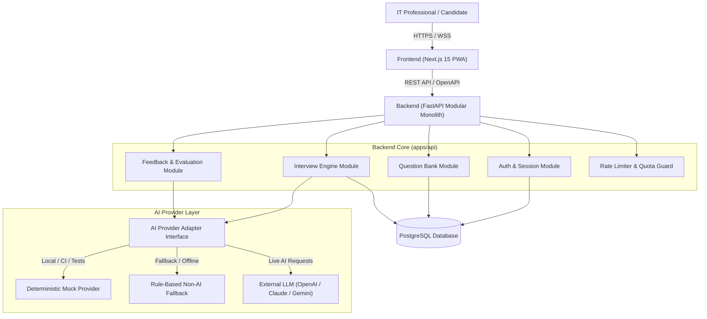
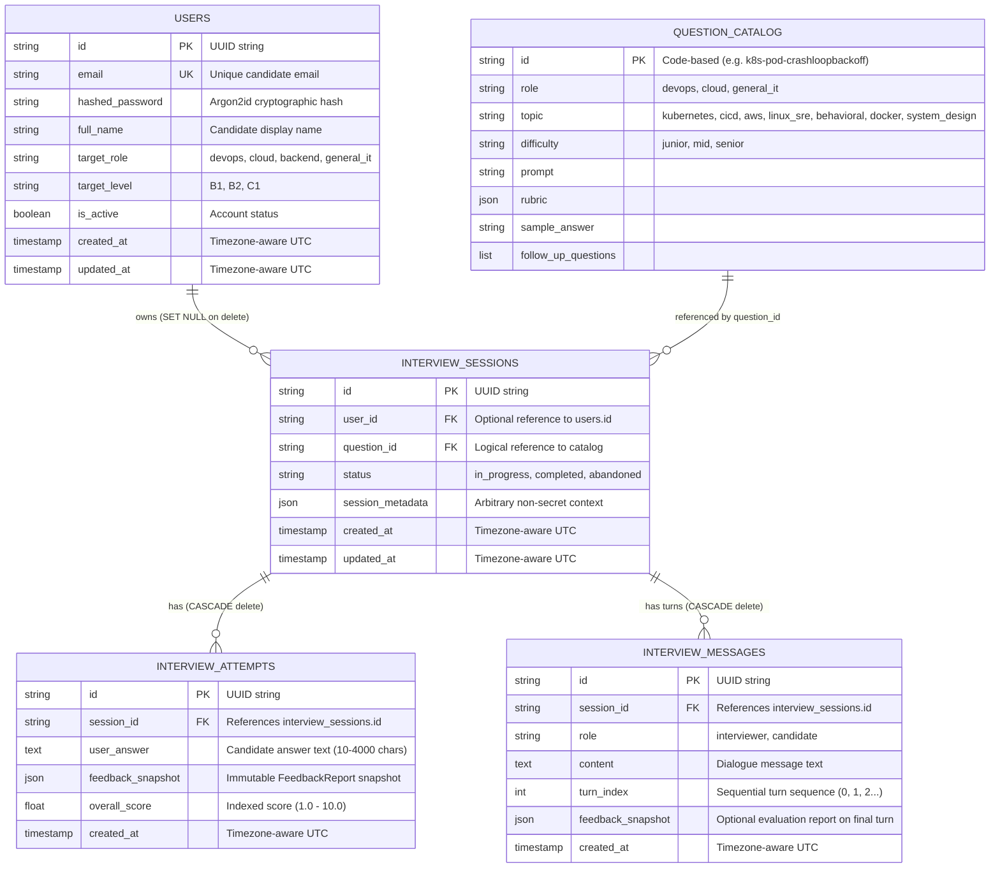
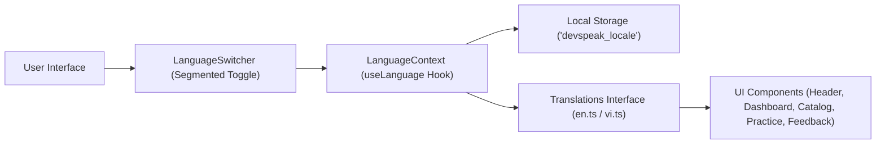
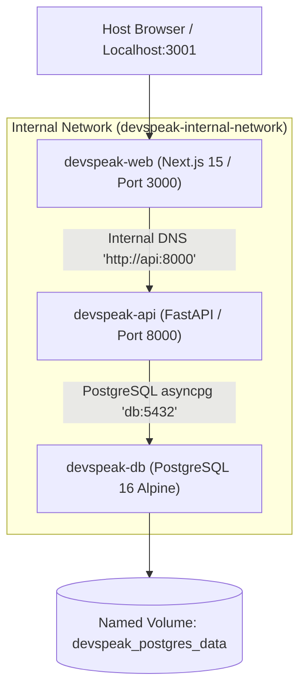

# System Architecture: DevSpeak AI

## 1. Architecture Overview & High-Level Diagram

DevSpeak AI follows a **modular monolith** backend architecture with a **responsive web/PWA** frontend, keeping business logic strictly separated from external AI providers and cloud infrastructure.



---

## 2. Implemented Architecture vs Target Architecture

| Component | Implemented State (Milestone 1 Slice) | Target State (Milestone 1 MVP) | Target Future State (Milestones 2+) |
| :--- | :--- | :--- | :--- |
| **Frontend** | Implemented & Verified (Next.js 15, React 19, TypeScript, Tailwind CSS, Question Catalog, Practice Studio, Feedback Studio) | Next.js 15 App Router, TypeScript, Tailwind CSS, React Query | PWA offline caching, Audio recorder / visualizer |
| **Backend** | Modular Monolith (FastAPI, Pydantic v2, in-memory catalog, 26 passing tests) | FastAPI, Pydantic v2, SQLAlchemy 2.0 (async), Alembic | Event-driven background tasks (Celery/Redis or asyncio) |
| **Database** | In-memory verified Question Catalog (0 cost) | PostgreSQL 16 (Local Docker Compose or managed Supabase) | Read replicas, automated backups, Point-In-Time recovery |
| **AI Layer** | AIProviderInterface + DeterministicMockAIProvider (offline, 0 cost) | Unified Adapter: MockProvider + Live Provider + NonAI fallback | Streaming audio STT/TTS pipeline, multi-agent evaluation |
| **Infrastructure** | Local native process (host Python 3.12, venv) | Docker Compose (Web, API, DB) | Local Kubernetes (KIND/k3d), Helm, Argo CD, Terraform |
| **Observability** | None | Structured JSON logging with request IDs, Healthchecks | Prometheus, Grafana, Loki, Alertmanager |

---

## 3. Component Details & Boundaries

### 3.1 Frontend (`apps/web`)
- **Framework**: Next.js 15 with App Router.
- **State & Data Fetching**: Server Components for static/SEO question catalogs; TanStack React Query for dynamic interview interactions.
- **UI & Styling**: Tailwind CSS, Lucide icons, accessible headless UI primitives.
- **Resilience**: Client-side fallback to non-AI mode when network requests fail or quota is exceeded.

### 3.2 Backend Modular Monolith (`apps/api`)
- **Package Layout**:
  - `core/`: Configuration, security utilities, database session management, telemetry.
  - `modules/auth/`: User accounts, password hashing (Argon2id), JWT / session tokens.
  - `modules/questions/`: Catalog queries, filtering, search, difficulty rating.
  - `modules/interviews/`: Session state machine (START -> QUESTION -> ANSWER -> FEEDBACK -> COMPLETE).
  - `modules/ai/`: Provider adapter abstraction, prompt engineering, structured response validation.
  - `modules/users/`: Practice history, metrics, daily quota tracking.

### 3.3 AI Adapter Interface & Concrete Implementations
The AI layer is strictly decoupled behind an abstract class `AIProviderInterface`:
```python
class AIProviderInterface(ABC):
    @abstractmethod
    async def evaluate_answer(
        self, question: Question, user_answer: str
    ) -> FeedbackReport:
        pass

    @abstractmethod
    async def generate_followup(
        self, question: Question, user_answer: str
    ) -> list[str]:
        pass
```

DevSpeak AI provides two concrete implementations selected via `AI_PROVIDER` environment variable:

1. **`DeterministicMockAIProvider` (`AI_PROVIDER=mock`)**:
   - Default zero-cost provider for local development, CI/CD pipelines, and offline evaluation.
   - Heuristically evaluates technical keyword coverage, sentence count, and STAR method components.
   - 100% reproducible: identical candidate input yields identical feedback scores.
   - Operates completely without network requests or API keys.

2. **`GeminiAIProvider` (`AI_PROVIDER=gemini`)**:
   - Production LLM provider integration using Google Gemini (`gemini-2.0-flash`).
   - Direct REST integration via `httpx.AsyncClient` (no heavy third-party SDK conflicts, zero-latency async pooling).
   - **Native Structured Outputs**: Configured with `responseMimeType: "application/json"` and strict `responseSchema` enforcing the exact `FeedbackReport` contract.
   - **Prompt Injection Isolation**: Encloses candidate responses strictly inside `<candidate_response>` XML tags, paired with explicit system instructions prohibiting execution of enclosed commands or override of grading criteria.
   - **Resilience & Retry**: Exponential backoff on transient errors (HTTP 429 rate limits, HTTP 503 service unavailable, read timeouts) up to `AI_MAX_RETRIES` (default: 2 retries).
   - **Graceful Error Mapping**: Specific exception hierarchy (`AIRateLimitError`, `AITimeoutError`, `AIConfigurationError`, `AIResponseValidationError`) mapped to HTTP 429, 504, 503, and 502 with sanitized messages to prevent secret and stack trace leakage.

---

## 4. Data Model & Persistence Architecture

The persistence architecture separates version-controlled static knowledge (the Question Bank) from dynamic runtime learning state (Sessions & Attempts).

- **Question Catalog**: Managed as declarative, version-controlled code artifacts (`src/modules/questions/catalog.py`). This guarantees zero database migration overhead for question updates and offline accessibility.
- **Relational Storage**: Implemented via **SQLAlchemy 2.x** with async drivers (`aiosqlite` for local zero-cost execution; `asyncpg` for PostgreSQL in production). Schema migrations are declaratively managed by **Alembic**.



### Deletion & Cascade Rules
- `User` entity owns registered accounts. When a user is deleted, associated sessions have their `user_id` set to NULL (`ondelete="SET NULL"`), preventing data corruption while preserving anonymized training data.
- `InterviewSession` acts as the aggregate root for candidate practice sessions.
- `InterviewAttempt` and `InterviewMessage` records have `ForeignKeyConstraint(..., ondelete="CASCADE")` and SQLAlchemy `cascade="all, delete-orphan"` mapping. Deleting an `InterviewSession` cleanly cascades to all historical evaluation attempts and conversation turn records.
- Authenticated candidates experience strict session isolation: sessions created by User A cannot be accessed or modified by User B (enforced by repository query filtering and 403 Forbidden guards in service layers). Anonymous practice remains fully functional for zero-friction guest evaluations.

---

## 5. Security & Trust Boundaries
- **Untrusted Input**: User answers and submitted prompts are sanitized and bounded in size (e.g., max 4000 characters).
- **Prompt Injection Defense**: User answers are passed strictly as data inputs within structured system prompts, never concatenated directly into system instructions.
- **Untrusted AI Output**: All LLM outputs are validated against Pydantic schemas with type enforcement and bounds checking before persisting or returning to the client.
- **Tenant Isolation**: Database queries for session history and feedback are always scoped by the authenticated `user_id`.


---

## 6. Bilingual Internationalization (i18n) Architecture

DevSpeak AI features a lightweight, typed bilingual layer (`en` / `vi`) engineered specifically for IT and DevOps professionals:



### 6.1 Architectural Principles
1. **Type-Safe Dictionary Schema**: All strings are defined under `Translations` in `apps/web/src/i18n/types.ts`. Both `en.ts` and `vi.ts` satisfy this contract with 100% key parity enforced by automated unit tests.
2. **SSR Hydration Safety**: The initial React state defaults to `'en'` on both server and client, eliminating SSR hydration mismatch. Client preferences are read from `localStorage.getItem('devspeak_locale')` on client mount inside a `useEffect`.
3. **Interview Learning Integrity Rule**:
   - Navigation, instructions, scoring dimension labels, feedback tabs, and rubric helper tips are localized in Vietnamese.
   - **Crucially, all technical question prompts, diagnostic commands (`kubectl describe pod`, `vmstat`, `NAT Gateway`), evaluated competencies, and canonical benchmark model answers remain strictly in English**, ensuring candidates build genuine confidence in international IT interviews.

---

## 7. DevSecOps & CI Quality Architecture

The continuous integration pipeline is defined in `.github/workflows/ci.yml` adhering to strict DevSecOps best practices:

- **Least Privilege Permissions**: Top-level `permissions: contents: read` restricts workflow tokens to read-only access.
- **Action Pinning**: Third-party GitHub Actions are pinned to full commit SHAs (`v4.2.2`, `v5.4.0`, etc.) with semantic comments to prevent supply-chain tampering.
- **Workflow Concurrency**: `cancel-in-progress: true` prevents redundant runs and optimizes CI resource consumption.
- **Zero-Cost Offline Testing**: CI runs with `AI_PROVIDER=mock`, requiring zero cloud credentials, external network requests, or paid LLM tokens.
- **Integrated SAST & Dependency Scanning**:
  - **Bandit SAST**: Scans backend source code for security anti-patterns (`bandit -r src`).
  - **pip-audit**: Audits Python runtime dependencies against the PyPA Advisory Database.
  - **Gitleaks**: Audits commits and pull requests for accidentally staged credentials or private keys.

---

## 8. Containerization & Local Orchestration Architecture

DevSpeak AI packages both frontend and backend as minimal, production-grade container images orchestrated by Docker Compose:



### 8.1 Security & Multi-Stage Image Design
1. **Backend (`apps/api/Dockerfile`)**:
   - Base: `python:3.12-slim-bookworm`.
   - Multi-stage pattern: Wheels compiled in `builder` stage; runner stage contains only runtime dependencies without build toolchains (`gcc`, `make`, etc.).
   - Non-root user: Runs under dedicated system user `appuser` (UID 10001, GID 10001).
   - Zero-dependency healthcheck: Uses Python standard library `urllib.request` probing `/readyz` every 15s.
   - Entrypoint automation: Automatically applies Alembic database migrations (`python -m alembic upgrade head`) on container startup before executing Uvicorn.
2. **Frontend (`apps/web/Dockerfile`)**:
   - Base: `node:22-alpine` with `libc6-compat`.
   - Multi-stage pattern: Isolated `deps` (cached `npm ci`), `builder` (`npm run build`), and `runner` stages.
   - Non-root user: Runs under system user `nextjs` (UID 1001, GID 1001).
   - Zero-dependency healthcheck: Uses Node.js standard library `http` module probing `/` every 15s.
3. **Orchestration (`docker-compose.yml`)**:
   - Enforces `security_opt: [no-new-privileges:true]` across all services.
   - Strict startup order: `api` waits for `db` to be healthy (`service_healthy`); `web` waits for `api` to be healthy.
   - Host port conflict resolution: Maps host port `3001` to container port `3000`, preventing conflicts with other local services on port 3000.
