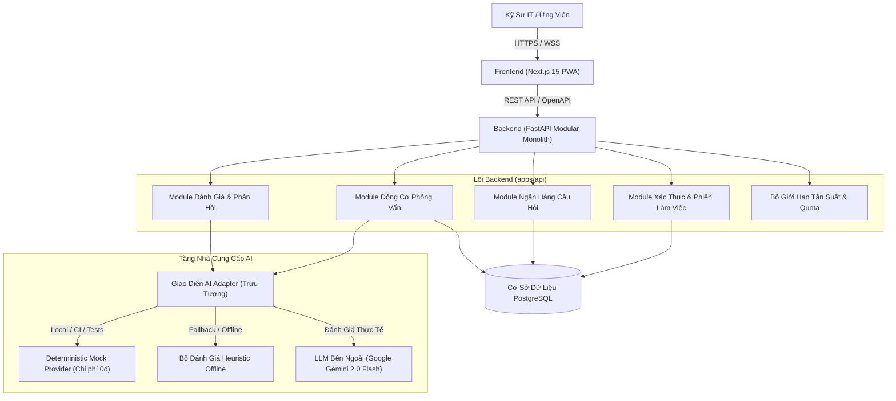
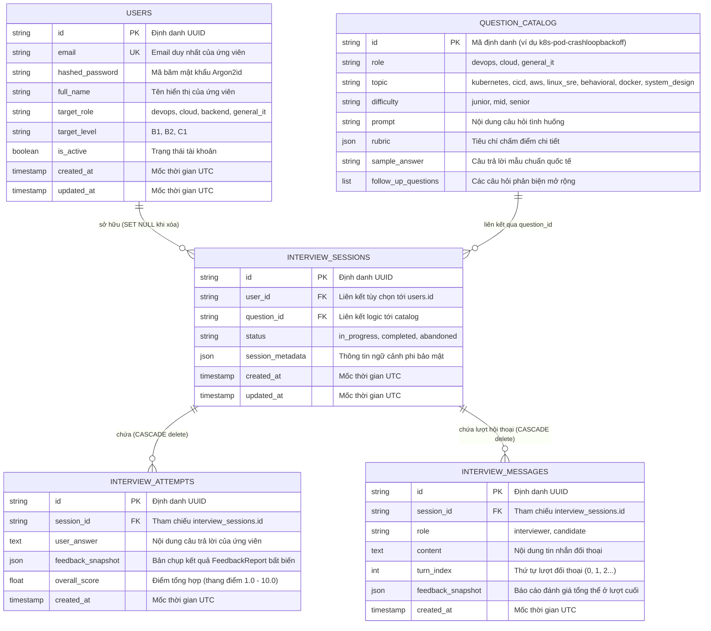
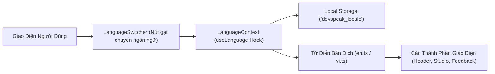

# Kiến Trúc Hệ Thống: DevSpeak AI

## 1. Tổng Quan Kiến Trúc & Sơ Đồ Cấp Cao

DevSpeak AI áp dụng mô hình kiến trúc **Modular Monolith** cho tầng Backend kết hợp với giao diện **Responsive Web / PWA** ở tầng Frontend. Thiết kế này phân tách triệt để logic nghiệp vụ khỏi các nhà cung cấp AI bên ngoài và hạ tầng đám mây.



---

## 2. So Sánh Kiến Trúc Thực Tế & Kiến Trúc Đích

| Thành phần | Hiện trạng thực tế đã kiểm định | Trạng thái MVP chuẩn | Trạng thái nâng cao (Tương lai) |
| :--- | :--- | :--- | :--- |
| **Frontend** | Đã triển khai và kiểm định (Next.js 15, React 19, TypeScript, Tailwind CSS, Question Catalog, Practice Studio, Feedback Studio) | Next.js 15 App Router, TypeScript, Tailwind CSS, React Query | Caching ngoại tuyến PWA, Ghi âm giọng nói streaming trực tiếp |
| **Backend** | Modular Monolith (FastAPI, Pydantic v2, SQLAlchemy 2.0 AsyncIO, 70 bài test tự động đạt) | FastAPI, Pydantic v2, SQLAlchemy 2.0 (async), Alembic | Tác vụ chạy ngầm phân tán (Celery/Redis hoặc AsyncIO workers) |
| **Cơ sở dữ liệu** | PostgreSQL 16 (Docker Compose / Cloud SQL) & SQLite (Local tests) | PostgreSQL 16 (Local Docker Compose hoặc Managed Cloud SQL) | Bản sao chỉ đọc (Read Replicas), Tự động sao lưu và PITR 7 ngày |
| **Tầng AI** | Bộ chuyển đổi thống nhất: MockProvider + Gemini Provider + NonAI fallback | Khớp hoàn toàn chuẩn thiết kế | Đánh giá đa tác tử (Multi-agent), phân tích ngữ điệu giọng nói |
| **Hạ tầng** | Hỗ trợ đầy đủ: Docker Compose, kind + Helm, Cloud Run, GKE Autopilot, Terraform | Docker Compose (Web, API, DB) | Tự động cân bằng tải đa vùng, Mesh mạng lưới dịch vụ |
| **Giám sát** | Health probes (`/healthz`, `/readyz`), nhật ký có cấu trúc, Cloud Logging | JSON logging có gắn mã định danh Request ID | Prometheus, Grafana, Loki, Alertmanager |

---

## 3. Chi Tiết Các Module & Ranh Giới Thành Phần

### 3.1 Tầng Frontend (`apps/web`)
- **Framework**: Next.js 15 sử dụng mô hình App Router.
- **Quản lý trạng thái & Nạp dữ liệu**: Server Components tối ưu SEO cho danh mục câu hỏi; React Query quản lý tương tác động trong phòng phỏng vấn.
- **Giao diện & Trải nghiệm**: Tailwind CSS, hệ thống icon Lucide, chuẩn trợ năng tiếp cận (Accessibility).
- **Khả năng chịu lỗi**: Tự động chuyển đổi mượt mà sang chế độ Mock offline khi mạng gián đoạn hoặc vượt ngưỡng giới hạn.

### 3.2 Tầng Backend Modular Monolith (`apps/api`)
- **Cấu trúc phân bổ package**:
  - `core/`: Cấu hình hệ thống, tiện ích bảo mật, quản lý phiên kết nối DB, đo lường từ xa (telemetry).
  - `modules/auth/`: Tài khoản ứng viên, băm mật khẩu chuẩn mã hóa Argon2id, quản lý token JWT.
  - `modules/questions/`: Truy vấn danh mục câu hỏi, lọc chủ đề, tìm kiếm, phân loại độ khó.
  - `modules/interviews/`: Máy trạng thái phiên phỏng vấn (START -> QUESTION -> ANSWER -> FEEDBACK -> COMPLETE).
  - `modules/ai/`: Trừu tượng hóa nhà cung cấp AI, kỹ nghệ nhắc lệnh (Prompt Engineering), kiểm định schema đầu ra.
  - `modules/users/`: Lịch sử luyện tập, tiến độ XP, giới hạn lượt thực hành hàng ngày.

### 3.3 Giao Diện Bộ Chuyển Đổi AI (AI Adapter Interface)
Tầng AI được tách biệt hoàn toàn đằng sau lớp trừu tượng `AIProviderInterface`:
```python
class AIProviderInterface(ABC):
    @abstractmethod
    async def evaluate_answer(
        self, question: Question, user_answer: str
    ) -> FeedbackReport:
        pass

    @abstractmethod
    async def generate_followup(
        self, question: Question, user_answer: str
    ) -> list[str]:
        pass
```

Hệ thống cung cấp hai hiện thực cụ thể được lựa chọn qua biến môi trường `AI_PROVIDER`:

1. **`DeterministicMockAIProvider` (`AI_PROVIDER=mock`)**:
   - Mặc định cho phát triển cục bộ, pipeline CI/CD và kiểm thử bảo mật.
   - Phân tích độ bao phủ từ khóa kỹ thuật, số lượng câu, cấu trúc khung STAR bằng thuật toán heuristic.
   - Khả năng tái lập kết quả 100%: cùng câu trả lời đầu vào luôn cho ra cùng điểm số.
   - Hoàn toàn không phát sinh cước phí và không cần mạng internet.

2. **`GeminiAIProvider` (`AI_PROVIDER=gemini`)**:
   - Tích hợp mô hình AI tạo sinh Google Gemini 2.0 Flash.
   - Gọi API REST trực tiếp qua `httpx.AsyncClient` tối ưu độ trễ và hỗ trợ async pool.
   - **Đầu ra có cấu trúc nguyên bản (Native Structured Outputs)**: Ép kiểu chặt chẽ bằng `responseMimeType: "application/json"` và schema Pydantic `FeedbackReport`.
   - **Cách ly tấn công tiêm nhiễm lệnh (Prompt Injection Isolation)**: Đặt câu trả lời của ứng viên trong thẻ XML `<candidate_response>` kèm chỉ dẫn hệ thống nghiêm cấm thực thi lệnh người dùng đưa vào.
   - **Khả năng tự phục hồi**: Tự động thử lại với thuật toán Exponential Backoff khi gặp mã lỗi 429 hoặc 503 tối đa `AI_MAX_RETRIES` lần.

---

## 4. Mô Hình Dữ Liệu & Kiến Trúc Lưu Trữ

Kiến trúc phân tách giữa tri thức tĩnh được kiểm soát qua Git (Ngân hàng câu hỏi) và dữ liệu động sinh ra trong quá trình học (Phiên phỏng vấn & Câu trả lời).

- **Danh Mục Câu Hỏi (Question Catalog)**: Quản lý dưới dạng code (`src/modules/questions/catalog.py`), bảo đảm không tốn chi phí migration DB và luôn sẵn sàng ngoại tuyến.
- **Lưu Trữ Quan Hệ**: Xây dựng bằng **SQLAlchemy 2.x** với driver bất đồng bộ (`aiosqlite` cho local; `asyncpg` cho PostgreSQL production). Cơ chế thay đổi lược đồ được quản lý bởi **Alembic**.



---

## 5. Ranh Giới Tin Cậy & Phòng Thủ An Ninh

- **Dữ Liệu Đầu Vào Không Tin Cậy**: Câu trả lời của người dùng được giới hạn độ dài nghiêm ngặt (10 - 4000 ký tự) và loại bỏ ký tự điều khiển nguy hiểm.
- **Cách Ly Tiêm Lệnh AI**: Tuyệt đối không ghép chuỗi câu trả lời người dùng trực tiếp vào System Prompt.
- **Dữ Liệu Đầu Ra AI Không Tin Cậy**: Mọi phản hồi từ LLM đều bắt buộc kiểm tra hợp lệ qua Schema Pydantic trước khi lưu trữ hoặc trả về giao diện.
- **Cô Lập Phiên Người Dùng**: Mọi truy vấn lịch sử học tập đều bắt buộc gắn với `user_id` của phiên xác thực hiện hành, bảo vệ tuyệt đối dữ liệu giữa các ứng viên.

---

## 6. Kiến Trúc Hỗ Trợ Đa Ngôn Ngữ Song Ngữ (i18n)

DevSpeak AI xây dựng tầng ngôn ngữ song ngữ (`en` / `vi`) chuyên biệt cho đối tượng kỹ sư công nghệ:



### Nguyên tắc vàng trong thiết kế ngôn ngữ:
1. **Toàn vẹn khóa bản dịch**: Cả hai tệp từ điển `en.ts` và `vi.ts` đều tuân thủ 100% interface TypeScript chặt chẽ, được kiểm chứng bằng unit test tự động.
2. **Quy tắc cốt lõi về luyện phỏng vấn kỹ thuật**:
   - Toàn bộ thanh điều hướng, tiêu đề, hướng dẫn sử dụng, phân tích điểm số và lời khuyên phản hồi đều được Việt hóa để ứng viên dễ hiểu.
   - **Tuy nhiên, các tình huống kỹ thuật, lệnh thao tác (`kubectl describe pod`, `vmstat`, `NAT Gateway`), tiêu chí chấm điểm và câu trả lời mẫu của chuyên gia được giữ nguyên bản tiếng Anh 100%**, giúp kỹ sư rèn luyện năng lực phản xạ tiếng Anh tự nhiên khi bước vào các cuộc phỏng vấn quốc tế thực thụ.
