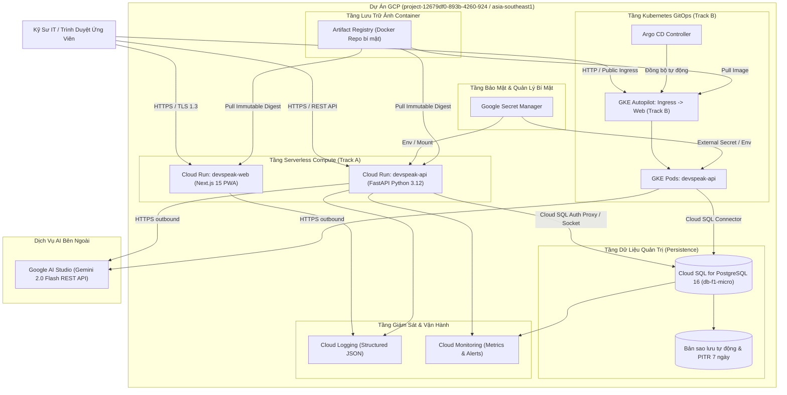

# Kiến Trúc Hạ Tầng Đám Mây Google Cloud Platform (GCP): DevSpeak AI

**Phiên bản**: 1.0.0  
**Tác giả**: Principal Cloud Architect & DevSecOps Lead  
**Phạm vi**: Triển khai thực tế trên GCP với mô hình kép Serverless (Track A) và Kubernetes GitOps (Track B)  

---

## 1. Tóm Tắt Thiết Kế & Các Nguyên Tắc Cốt Lõi

DevSpeak AI được thiết kế hướng tới môi trường đám mây chuẩn doanh nghiệp trên nền tảng **Google Cloud Platform (GCP)**. Để tối ưu tốc độ triển khai, đảm bảo kỷ luật tài chính nghiêm ngặt trong giới hạn **$300 USD Google Cloud Free Trial**, và biểu diễn năng lực DevSecOps chuyên sâu, kiến trúc tuân thủ 6 nguyên tắc cốt lõi:

1. **Điện Toán Serverless Tự Động Co Giãn Về 0 (Scale-to-Zero)**: Tách biệt Frontend và Backend thành các dịch vụ **Cloud Run** độc lập. Chi phí tính toán là $0.00 khi nhàn rỗi.
2. **Nền Tảng Kubernetes & GitOps (Track B)**: Tận dụng **GKE Autopilot** với chi phí quản lý cụm $0 cho cụm đầu tiên, kết hợp **Argo CD** tự động đồng bộ khai báo từ Git.
3. **Quản Lý Dữ Liệu Bền Vững & Tối Ưu Chi Phí**: Sử dụng **Cloud SQL for PostgreSQL 16** (`db-f1-micro`) với kết nối Unix Domain Socket qua Cloud SQL Auth Proxy, sao lưu tự động và phục hồi PITR 7 ngày.
4. **Xác Thực Không Dùng Khóa Tĩnh (Keyless WIF)**: Ứng dụng **Workload Identity Federation (WIF)** kết nối GitHub Actions OIDC với GCP IAM, hoàn toàn không tạo Service Account JSON key tĩnh.
5. **Bảo Mật Đa Tầng (Defense-in-Depth DevSecOps)**: Quét mã nguồn tĩnh SAST, kiểm tra lỗ hổng phụ thuộc, quét rò rỉ bí mật và kiểm định lỗ hổng container image.
6. **Quản Lý Bí Mật Tập Trung (Zero-Trust Secret Manager)**: Mật khẩu CSDL, khóa JWT và Gemini API key được lưu tập trung trong **Google Secret Manager**, nạp vào runtime mà không lộ ra ngoài.

---

## 2. Sơ Đồ Kiến Trúc Đích Cấp Cao (GCP Architecture Diagram)

---

## 3. Chi Tiết Các Tầng Dịch Vụ GCP

### 3.1 Tầng Frontend & Backend Cloud Run (Track A)
- **`devspeak-web-prod`**: Next.js 15 Standalone PWA, cấu hình `min_instances=0`, `max_instances=2`, tài nguyên 1 vCPU, 512MB RAM.
- **`devspeak-api-prod`**: FastAPI Python 3.12, cấu hình `min_instances=0`, `max_instances=3`, tài nguyên 1 vCPU, 512MB RAM.
- **Cơ chế Cold-Start**: Sử dụng probe `/readyz` nhẹ (< 50ms) kết hợp lazy loading các module nặng để giảm thời gian khởi động lạnh xuống dưới 3.5 giây.

### 3.2 Tầng Kubernetes GKE Autopilot & Argo CD (Track B)
- **Cụm Autopilot**: Cung cấp khả năng tự co giãn Node, quản trị tự động hệ điều hành node và tối ưu bảo mật theo chuẩn CIS Kubernetes Benchmark.
- **Helm & Argo CD**: Toàn bộ ứng dụng được định nghĩa qua Helm Chart và khai báo trong thư mục `deploy/gitops/`. Argo CD liên tục đối soát trạng thái Git và cụm GKE, tự động khắc phục sai lệch (drift).

### 3.3 Tầng Cơ Sở Dữ Liệu Cloud SQL
- **Phiên bản**: PostgreSQL 16.
- **Cấu hình máy**: `db-f1-micro` (1 shared vCPU, 0.6 GB RAM, 10 GB SSD).
- **Chiến lược phục hồi thảm họa (Disaster Recovery)**:
  - Sao lưu tự động hàng ngày (Automated Daily Backups) vào khung giờ 03:00 UTC.
  - Ghi nhật ký giao dịch Point-in-Time Recovery (PITR) trong 7 ngày.
  - Bật cờ bảo vệ chống xóa nhầm (`deletion_protection = true`).

### 3.4 Xác Thực CI/CD Qua Workload Identity Federation (WIF)
- Pipeline GitHub Actions không lưu trữ bất kỳ file JSON key nào.
- Luồng xác thực: GitHub cấp token OIDC -> GCP WIF Pool xác thực danh tính -> Cấp quyền truy cập ngắn hạn cho Service Account triển khai.
- Giới hạn quyền: Service Account Production chỉ gắn với `repo:nguyenlpn2015/DevSpeak-AI:ref:refs/heads/main`.
