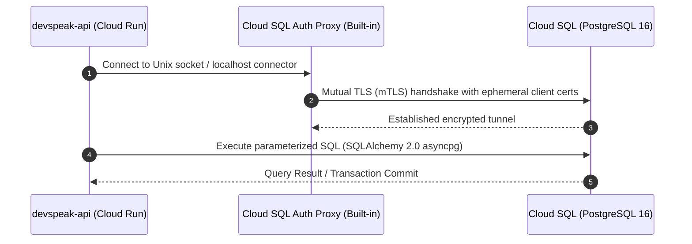
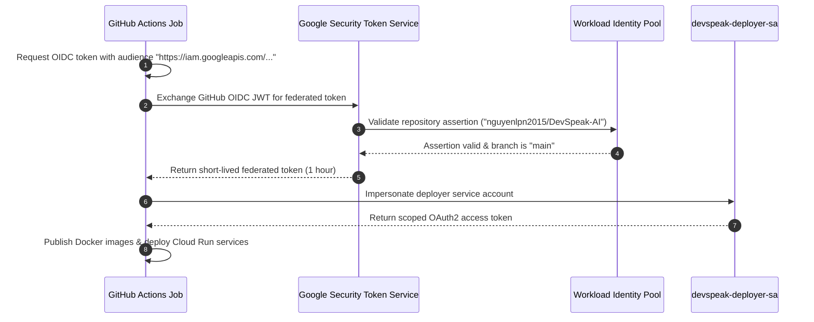

# DevSpeak AI — Google Cloud Platform Production Architecture

**Document Version**: 1.0.0  
**Phase**: Phase 0 — Target Cloud Architecture  
**Author**: Principal Cloud Architect & DevSecOps Lead  
**Scope**: Production-Minded, Scale-to-Zero Cloud Run Deployment on GCP  

---

## 1. Executive Summary & Design Principles

DevSpeak AI is transitioning from a local multi-container development environment to a secure, observable, cost-governed production deployment on **Google Cloud Platform (GCP)**. 

To maximize developer velocity, maintain strict cost discipline under the **$300 Google Cloud Free Trial**, and showcase enterprise DevSecOps engineering rigor, the architecture adopts the following core design principles:

1. **Scale-to-Zero Serverless Compute**: Deploy decoupled Frontend and Backend as independent **Cloud Run** services. Pay $0.00 when instances are idle, eliminating the massive idle compute costs of always-on Kubernetes clusters or Virtual Machines.
2. **Managed Persistence with Cost Bounds**: Use **Cloud SQL for PostgreSQL** on the smallest suitable tier (`db-f1-micro` for development/portfolio showcase), with automated daily backups, private networking, and connection pooling.
3. **Keyless, Short-Lived CI/CD Identity**: Implement **Workload Identity Federation (WIF)** with GitHub Actions OIDC. **Zero long-lived service account JSON keys** are created, stored, or exposed in GitHub Secrets.
4. **Defense-in-Depth DevSecOps**: Enforce multi-layered static analysis, dependency scanning, secret leak detection, container vulnerability scanning, and infrastructure-as-code linting.
5. **Zero-Trust Secret Management**: Inject database credentials, JWT keys, and Gemini API keys directly from **Google Secret Manager** at container runtime. Secrets are never embedded in container image layers, client-side bundles, or Git commits.
6. **Unified Telemetry & Observability**: Standardize structured JSON logging and capture runtime metrics, cold-starts, database latencies, and AI provider errors using **Cloud Logging** and **Cloud Monitoring**.

---

## 2. High-Level Target Architecture Diagram

```mermaid
graph TD
    User["IT Professional / Candidate Browser"] -->|HTTPS (TLS 1.3)| CloudRunWeb["Cloud Run: devspeak-web (Next.js 15 PWA)"]
    User -->|HTTPS (REST API / JWT)| CloudRunAPI["Cloud Run: devspeak-api (FastAPI Python 3.12)"]

    subgraph "GCP Project (devspeak-ai-prod / Single Region: asia-southeast1)"
        subgraph "Serverless Compute Tier (Cloud Run)"
            CloudRunWeb
            CloudRunAPI
        end

        subgraph "Managed Persistence Tier"
            CloudSQL[("Cloud SQL for PostgreSQL 16 (db-f1-micro)")]
            CloudSQLBackup[("Automated Backups (7-day retention)")]
            CloudSQL --> CloudSQLBackup
        end

        subgraph "Security & Secrets Tier"
            SecretManager["Google Secret Manager"]
            SecretManager -->|Mount / Env| CloudRunAPI
        end

        subgraph "Container Registry Tier"
            ArtifactRegistry["Artifact Registry (Private Docker Repository)"]
            ArtifactRegistry -->|Pull Immutable Digest| CloudRunWeb
            ArtifactRegistry -->|Pull Immutable Digest| CloudRunAPI
        end

        subgraph "Observability Tier"
            CloudLogging["Cloud Logging (Structured JSON)"]
            CloudMonitoring["Cloud Monitoring (Metrics & Alerts)"]
            CloudRunWeb --> CloudLogging
            CloudRunAPI --> CloudLogging
            CloudRunAPI --> CloudMonitoring
            CloudSQL --> CloudMonitoring
        end

        CloudRunAPI -->|Cloud SQL Auth Proxy / Unix Socket| CloudSQL
    end

    subgraph "External AI Services"
        GoogleAI["Google AI Studio (Gemini 2.0 Flash REST API)"]
        CloudRunAPI -->|HTTPS outbound (apiKey in header)| GoogleAI
    end

    subgraph "CI/CD & Delivery (GitHub Actions)"
        GitHubRepo["GitHub Repository (nguyenlpn2015/DevSpeak-AI)"]
        GitHubActions["GitHub Actions Runner"]
        WIF["Workload Identity Federation (OIDC Pool/Provider)"]

        GitHubRepo --> GitHubActions
        GitHubActions -->|OIDC Token Exchange| WIF
        WIF -->|Short-lived STS Token| DeploySA["Deployer Service Account"]
        DeploySA -->|Publish Images| ArtifactRegistry
        DeploySA -->|Deploy Revisions| CloudRunWeb
        DeploySA -->|Deploy Revisions| CloudRunAPI
    end
```

---

## 3. End-to-End Request and Data Flows

### 3.1 Web Client to Backend Flow
1. **Initial Page Load**: Candidate's browser requests the web application via HTTPS. Google Cloud Run's global anycast load balancer terminates TLS 1.3 and routes the request to an available `devspeak-web` container instance (scaling up from 0 if necessary).
2. **API Interaction**: When the candidate registers, browses questions, or submits an interview answer, the frontend client makes asynchronous `fetch()` requests directly to the `devspeak-api` Cloud Run HTTPS endpoint.
3. **CORS Validation**: `devspeak-api` validates the incoming `Origin` header against `CORS_ORIGINS` (which explicitly allows the `devspeak-web` Cloud Run URL).
4. **Authentication**: All protected endpoints require a signed JWT token in the `Authorization: Bearer <token>` header, verified statelessly using `JWT_SECRET_KEY` fetched from Secret Manager.

### 3.2 Backend to Database Access Flow

- **Connection Strategy**: Cloud Run connects to Cloud SQL using the native Cloud SQL connector / Cloud SQL Auth Proxy built into Cloud Run (`--add-cloudsql-instances`).
- **Security**: No public IP is exposed on the database. All connections use ephemeral client certificates with mutual TLS (mTLS) rotated automatically.
- **Connection Pooling**: SQLAlchemy pool size is capped (`pool_size=5`, `max_overflow=2`) to prevent exhausting Cloud SQL connection limits when Cloud Run scales out.

### 3.3 AI Evaluation Request Flow
1. **Input Sanitization**: Candidate answer is validated at the FastAPI boundary (`min_length=10`, `max_length=4000`).
2. **Prompt Boundary Isolation**: The answer is enclosed strictly inside XML tags `<candidate_response>` to neutralize prompt injection attacks.
3. **Execution Routing**:
   - If `AI_PROVIDER=mock`: Deterministic rule-based evaluation executes locally in RAM with 0 latency and $0.00 cost.
   - If `AI_PROVIDER=gemini`: The backend issues an HTTPS POST request to Google AI Studio using `httpx.AsyncClient` with a 25-second timeout and 2 exponential backoff retries.
4. **Structured Schema Enforcement**: Gemini response is validated against the exact Pydantic `FeedbackReport` schema before persisting to PostgreSQL.

---

## 4. Trust Boundaries & Security Architecture

```
[ UNTRUSTED ZONE: Public Internet ]
      │
      ▼ (TLS 1.3 Termination, WAF Rate Limiting)
[ PERIMETER ZONE: Cloud Run Ingress ]
      │
      ├─► devspeak-web (Runs as non-root UID 1001)
      │
      ▼ (HTTPS + Bearer JWT Authentication)
[ APPLICATION ZONE: devspeak-api ]
      │ (Runs as non-root UID 10001)
      │ (Strict Schema Validation via Pydantic)
      │
      ├─► Cloud SQL Auth Proxy (mTLS Tunnel) ──► [ DATA ZONE: Cloud SQL ]
      │                                         (Private, No Public IP, AES-256 Encrypted)
      │
      ├─► IAM Authenticated Secret API ───────► [ SECRETS ZONE: Secret Manager ]
      │                                         (GEMINI_API_KEY, JWT_SECRET, DB_PASSWORD)
      │
      ▼ (Outbound TLS to Google AI Studio)
[ EXTERNAL API ZONE: Google Gemini ]
```

### Trust Boundary Rules:
1. **Client Boundary**: Any payload from the browser is hostile until validated by Pydantic.
2. **Secrets Boundary**: Client code never receives raw API keys, database passwords, or JWT secrets. `NEXT_PUBLIC_*` is strictly forbidden from referencing private credentials.
3. **Database Boundary**: Cloud SQL is not reachable from the public internet. Access is restricted exclusively to the `devspeak-api-sa` runtime identity via the Cloud SQL Auth Proxy.

---

## 5. Identity & Permissions Architecture (IAM & WIF)

### 5.1 Service Accounts & Least Privilege
The architecture provisions three dedicated service accounts, avoiding any use of the default Compute Engine service account:

| Service Account | Identifier | Assigned IAM Roles | Purpose |
| :--- | :--- | :--- | :--- |
| **Backend Runtime SA** | `devspeak-api-sa` | - `roles/cloudsql.client`<br>- `roles/secretmanager.secretAccessor`<br>- `roles/logging.logWriter`<br>- `roles/monitoring.metricWriter` | Runs the FastAPI container; accesses DB, secrets, and telemetry only. |
| **Frontend Runtime SA** | `devspeak-web-sa` | - `roles/logging.logWriter` | Runs the Next.js container; has zero access to DB or Secret Manager. |
| **CI/CD Deployment SA** | `devspeak-deployer-sa` | - `roles/run.admin`<br>- `roles/artifactregistry.writer`<br>- `roles/iam.serviceAccountUser` | Assumed temporarily by GitHub Actions via WIF to publish images and deploy revisions. |

### 5.2 Workload Identity Federation (WIF) Workflow


---

## 6. Failure Modes & Operational Resilience

| Failure Scenario | Impact | Mitigation Strategy | Observability Signal |
| :--- | :--- | :--- | :--- |
| **Cloud SQL Connection Failure** | Backend cannot persist attempts | Cloud Run healthcheck `/readyz` fails; requests return HTTP 503; client falls back to local storage | Cloud Monitoring alert: `database_connection_errors > 0` |
| **Gemini API Outage / 429** | AI evaluation fails | Backend catches `AIRateLimitError` / `AITimeoutError`; retries up to 2 times; falls back to deterministic heuristic mock | Cloud Logging: `severity=WARNING, ai_provider_error` |
| **High Traffic Spike** | Instance concurrency saturated | Cloud Run scales out up to `max_instances=5`; requests queue gracefully | Cloud Run metric: `container/instance_count` |
| **Container Cold Start** | Initial request latency ~1.5s–2.5s | Next.js and FastAPI containers are optimized with multi-stage slim images (< 150MB); lightweight Python modules | Cloud Run metric: `container/startup_latencies` |
| **Faulty Image Deployed** | New revision crashes on start | Cloud Run startup probe detects failure; automatically preserves 100% traffic on the previous healthy revision | Cloud Monitoring alert: `deployment_failure` |

---

## 7. Cost-Sensitive Resources & Governance Summary

To guarantee that the **$300 Google Cloud Free Trial** is strictly preserved:

1. **Cloud Run**: Both services set `min_instances = 0` (scale-to-zero when idle). Free tier covers 2,000,000 requests and 360,000 vCPU-seconds monthly. Expected cost: **$0.00 – $2.00 / month**.
2. **Cloud SQL**: Configured on `db-f1-micro` (1 shared vCPU, 0.6 GB RAM, 10 GB SSD storage, single-zone, NO high availability replica). Expected cost: **~$10.50 / month**.
3. **Artifact Registry**: Configured with a retention cleanup policy keeping only the latest 3 image versions. Expected cost: **<$0.10 / month**.
4. **Prohibited Resources**:
   - ❌ NO Google Kubernetes Engine (GKE) clusters ($74+/mo management fee).
   - ❌ NO Cloud NAT or Compute Engine VMs ($32+/mo idle charge).
   - ❌ NO External HTTP(S) Load Balancer forwarding rules ($18+/mo idle charge).
   - ❌ NO GPU accelerators.
