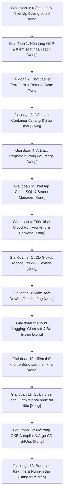

# Kế Hoạch Triển Khai Tổng Thể Trên Google Cloud Platform (GCP Master Plan)

**Dự Án**: DevSpeak AI (Nâng Cấp Hệ Thống DevSecOps & Cloud Platform Portfolio)  
**Môi Trường Triển Khai**: Google Cloud Platform (Cloud Run, Cloud SQL, Secret Manager, Artifact Registry, WIF, GKE Autopilot, Argo CD)  
**Chiến Lược Thực Thi**: Từng bước dựa trên bằng chứng kiểm định, quản trị ngân sách nghiêm ngặt (Giai đoạn 0 — 13).

---

## 1. Sơ Đồ Lộ Trình Triển Khai Tổng Thể

---

## 2. Chi Tiết Các Giai Đoạn Thực Thi

### Giai đoạn 0: Kiểm Định & Thiết Lập Đường Cơ Sở
- **Mục tiêu**: Rà soát hệ thống tệp và runtime cục bộ; xác thực bộ kiểm thử; xây dựng đặc tả kiến trúc và dự toán chi phí.
- **Trạng thái**: 🟢 **Hoàn thành**

### Giai đoạn 1: Thiết Lập Dự Án GCP & Kiểm Soát Ngân Sách
- **Mục tiêu**: Khởi tạo dự án `project-12679df0-893b-4260-924`, chọn vùng `asia-southeast1` (Singapore), bật các API cần thiết (`run`, `sqladmin`, `secretmanager`, `artifactregistry`, `iam`, `container`).
- **Trạng thái**: 🟢 **Hoàn thành**

### Giai đoạn 2: Hạ Tầng Dưới Dạng Mã (Terraform IaC)
- **Mục tiêu**: Xây dựng cấu trúc module Terraform tái sử dụng tại `infra/terraform/` với GCS remote state lưu trong bucket `devspeak-tf-state-project-12679df0-893b-4260-924`.
- **Trạng thái**: 🟢 **Hoàn thành**

### Giai đoạn 3 & 4: Đóng Gói Container & Artifact Registry
- **Mục tiêu**: Đóng gói Docker đa tầng không chạy root (`appuser`, `nextjs`), thiết lập kho lưu trữ riêng tư `devspeak-docker` tại Singapore với chính sách dọn dẹp giữ 3 tag gần nhất.
- **Trạng thái**: 🟢 **Hoàn thành**

### Giai đoạn 5 & 6: Triển Khai Cloud SQL & Cloud Run (Track A)
- **Mục tiêu**:
  - Khởi tạo Cloud SQL PostgreSQL 16 (`db-f1-micro`) với sao lưu hàng ngày và PITR 7 ngày.
  - Lưu trữ khóa bảo mật trong Google Secret Manager.
  - Triển khai Cloud Run Staging và Production với tính năng scale-to-zero.
- **Trạng thái**: 🟢 **Hoàn thành** (Đã kiểm định hoạt động thực tế).

### Giai đoạn 7 & 8: Tự Động Hóa CI/CD & DevSecOps Keyless WIF
- **Mục tiêu**:
  - Cấu hình Workload Identity Federation (WIF) thay thế toàn bộ khóa JSON tĩnh.
  - Củng cố IAM Production chỉ cho phép nhánh `main` kích hoạt deployer.
  - Tích hợp kiểm thử tự động, linting và quét lỗ hổng trong GitHub Actions.
- **Trạng thái**: 🟢 **Hoàn thành & Đã củng cố bảo mật**

### Giai đoạn 9 & 10: Giám Sát Vận Hành & Smoke Test Tự Động
- **Mục tiêu**: Chuẩn hóa log có cấu trúc dạng JSON lên Cloud Logging, kiểm tra probe `/readyz` tự động sau mỗi lần deploy.
- **Trạng thái**: 🟢 **Hoàn thành**

### Giai đoạn 11 & 12: Mở Rộng Track B (GKE Autopilot + Argo CD)
- **Mục tiêu**:
  - Khởi tạo cụm GKE Autopilot `devspeak-gke-portfolio`.
  - Triển khai Ingress NGINX và cài đặt Argo CD.
  - Đồng bộ tự động Helm Chart từ GitOps repository.
  - Khắc phục lỗi tiền tố `/api/v1` và cập nhật bản vá v1.0.2-candidate.
- **Trạng thái**: 🟢 **Hoàn thành**

### Giai đoạn 13: Bàn Giao Kỹ Thuật & Nghiệm Thu Sản Phẩm
- **Mục tiêu**: Nghiệm thu đồng thời cả 5 môi trường, hoàn thiện tài liệu hướng dẫn bằng tiếng Việt, đảm bảo an toàn tuyệt đối thông tin bí mật và dự toán FinOps an toàn.
- **Trạng thái**: 🟡 **Đang tiến hành bàn giao**
