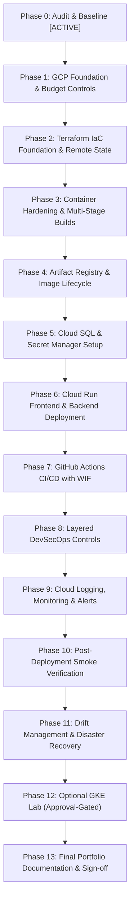

# DevSpeak AI — Google Cloud Platform Master Implementation Plan

**Project**: DevSpeak AI (GCP DevOps & DevSecOps Portfolio Evolution)  
**Target Environment**: Google Cloud Platform (Cloud Run, Cloud SQL, Secret Manager, Artifact Registry, WIF)  
**Execution Strategy**: Incremental, Evidence-Based, Budget-Governed (Phases 0 — 13)  

---

## 1. Master Phased Execution Roadmap



---

## 2. Phase-by-Phase Execution Breakdown

### Phase 0: Audit & Baseline (Current Phase)
- **Objective**: Conduct deep filesystem and runtime audit; verify local tests; identify hard-coded localhost references; author architectural and cost specifications.
- **Tasks**:
  1. Audit Git status, remotes, branches, and staged files.
  2. Run baseline Python tests (`pytest` 65 passed) and Web tests (`vitest` 44 passed, type-check, lint, build).
  3. Audit environment variables by name without exposing secrets.
  4. Verify container build assumptions and localhost URL hardcoding risks.
  5. Author `docs/GCP_ARCHITECTURE.md`, `docs/COST_ESTIMATE.md`, `docs/THREAT_MODEL.md`, `docs/GCP_IMPLEMENTATION_PLAN.md`, and `docs/RELEASE_EVIDENCE.md`.
- **Deliverables**: Complete 5-document Phase 0 architectural package.
- **Verification Gate**: 100% test pass rate; zero billable resources created.

---

### Phase 1: GCP Project Foundation & Budget Controls
- **Objective**: Establish the target GCP project, region, service APIs, and billing alerts.
- **Tasks**:
  1. Verify active GCP project ID and ensure billing account with $300 Free Trial is attached.
  2. Select target region: `asia-southeast1` (Singapore) for low latency to Vietnam, or `us-central1` for maximum free tier eligibility.
  3. Configure Google Cloud Budget Alert: $25.00/month threshold with notifications at 50%, 75%, 90%, 100%.
  4. Enable required service APIs:
     - `run.googleapis.com` (Cloud Run)
     - `sqladmin.googleapis.com` (Cloud SQL)
     - `secretmanager.googleapis.com` (Secret Manager)
     - `artifactregistry.googleapis.com` (Artifact Registry)
     - `iam.googleapis.com` (IAM)
     - `cloudresourcemanager.googleapis.com` (Resource Manager)
     - `iamcredentials.googleapis.com` (Workload Identity Federation)
     - `logging.googleapis.com` & `monitoring.googleapis.com`
- **Verification Gate**: Billing alerts configured; required APIs enabled with zero compute resources running.

---

### Phase 2: Terraform IaC Foundation & Remote State
- **Objective**: Build reusable, maintainable Terraform modules under `infra/terraform/` using GCS remote state.
- **Structure**:
  ```
  infra/terraform/
  ├── environments/
  │   └── prod/
  │       ├── main.tf
  │       ├── variables.tf
  │       ├── outputs.tf
  │       ├── terraform.tfvars.example
  │       └── backend.tf
  └── modules/
      ├── project_services/
      ├── artifact_registry/
      ├── service_accounts/
      ├── secret_manager/
      ├── cloud_sql/
      ├── cloud_run/
      └── monitoring/
  ```
- **Tasks**:
  1. Create GCS remote state bucket `devspeak-tf-state` with uniform bucket-level access, public access prevention, and versioning.
  2. Author modular Terraform declarations with strict variable types and descriptions.
  3. Pin Google Cloud provider version (`hashicorp/google ~> 6.0`).
  4. Run `terraform fmt`, `terraform validate`, and Checkov IaC security scan.
- **Verification Gate**: `terraform validate` passes; Checkov returns 0 HIGH/CRITICAL issues; state bucket encrypted and private.

---

### Phase 3: Container Hardening & Multi-Stage Optimization
- **Objective**: Harden Dockerfiles for production Cloud Run deployment.
- **Tasks**:
  1. Optimize `apps/api/Dockerfile`: Non-root `appuser:10001`, Python stdlib healthcheck, Alembic auto-migration handling.
  2. Optimize `apps/web/Dockerfile`: Non-root `nextjs:1001`, support Next.js standalone build (`output: 'standalone'`), dynamic runtime API URL resolution.
  3. Ensure both containers respect the dynamic `$PORT` environment variable injected by Cloud Run.
  4. Validate local builds: `docker build -t devspeak-api apps/api` and `docker build -t devspeak-web apps/web`.
- **Verification Gate**: Containers build cleanly without root permissions; images run locally in standalone mode.

---

### Phase 4: Artifact Registry & Image Lifecycle
- **Objective**: Establish private Docker registry with cost-controlled retention policy.
- **Tasks**:
  1. Provision Artifact Registry repository `devspeak-docker` via Terraform module.
  2. Configure cleanup policy: retain tagged images for 14 days, keep minimum 3 versions, automatically purge untagged images.
  3. Grant `roles/artifactregistry.reader` to Cloud Run service accounts and `roles/artifactregistry.writer` to CI/CD deployer service account.
- **Verification Gate**: Private registry created; push and pull verified using short-lived tokens.

---

### Phase 5: Cloud SQL & Secret Manager Setup
- **Objective**: Provision cost-bounded PostgreSQL database and secure credential storage.
- **Tasks**:
  1. Provision Cloud SQL PostgreSQL 16 on `db-f1-micro` with 10 GB SSD storage, automated daily backups, and no public IP.
  2. Create database `devspeak` and application user `devspeak_user`.
  3. Store secrets in Secret Manager:
     - `devspeak-db-password`
     - `devspeak-db-url`
     - `devspeak-jwt-secret`
     - `devspeak-gemini-api-key` (Optional; defaults to Mock)
  4. Grant `roles/secretmanager.secretAccessor` to `devspeak-api-sa`.
- **Verification Gate**: Secrets stored securely; database reachable only via Cloud SQL Auth Proxy; no credentials in Git.

---

### Phase 6: Cloud Run Frontend & Backend Deployment
- **Objective**: Deploy separate, scale-to-zero Cloud Run services for API and Web.
- **Tasks**:
  1. Deploy `devspeak-api`:
     - Runtime SA: `devspeak-api-sa`
     - Resource limits: 1 vCPU, 512 MiB RAM
     - Scaling: `min_instances=0`, `max_instances=3`
     - Environment: `AI_PROVIDER=mock`, `DATABASE_URL` linked to Secret Manager
     - Cloud SQL Auth Proxy connection enabled
     - Health probes configured to `/healthz` and `/readyz`
  2. Deploy `devspeak-web`:
     - Runtime SA: `devspeak-web-sa`
     - Resource limits: 1 vCPU, 512 MiB RAM
     - Scaling: `min_instances=0`, `max_instances=2`
     - Environment: `NEXT_PUBLIC_API_URL` pointing to the deployed API Cloud Run HTTPS URL
  3. Update `CORS_ORIGINS` in `devspeak-api` to accept traffic from the `devspeak-web` Cloud Run URL.
- **Verification Gate**: Both Cloud Run URLs respond with HTTP 200 over HTTPS; frontend seamlessly communicates with backend.

---

### Phase 7: GitHub Actions CI/CD with Workload Identity Federation (WIF)
- **Objective**: Fully automated, keyless deployment pipeline.
- **Tasks**:
  1. Provision Workload Identity Pool `github-actions-pool` and Provider `github-actions-provider`.
  2. Configure attribute mapping and strict repository assertion (`nguyenlpn2015/DevSpeak-AI`).
  3. Update `.github/workflows/cd.yml`:
     - Step 1: OIDC authentication via `google-github-actions/auth`.
     - Step 2: Build & scan container images with Trivy.
     - Step 3: Publish immutable images tagged with Git commit SHA.
     - Step 4: Deploy Cloud Run revisions using image digests.
     - Step 5: Execute post-deployment health check smoke tests.
- **Verification Gate**: Pull request triggers CI test gate; push to `main` deploys to Cloud Run with zero service account keys stored in GitHub Secrets.

---

### Phase 8: Layered DevSecOps Controls
- **Objective**: Enforce security gates across source code, dependencies, containers, and IaC.
- **Controls**:
  - Source: Gitleaks, Bandit SAST, Ruff linter.
  - Dependencies: `pip-audit`, `npm audit`.
  - IaC: Checkov / Trivy config for Terraform manifests.
  - Containers: Trivy vulnerability scanning (< 0 Critical/High).
  - Supply Chain: Syft Software Bill of Materials (SBOM) generation.
- **Verification Gate**: All security checks automated in CI; vulnerability exceptions documented in threat model.

---

### Phase 9: Cloud Logging, Monitoring & Observability
- **Objective**: Implement real-time monitoring and operational dashboards.
- **Tasks**:
  1. Create Cloud Monitoring Dashboard: Request rate, Latency p50/p95/p99, HTTP 4xx/5xx error rates, Active Cloud Run instances, and Database connections.
  2. Configure Alert Policies: High error rate (> 5% for 5 min), Cloud Run container crash loop, Database connectivity failure.
  3. Author `docs/OPERATIONS_RUNBOOK.md` covering incident response, secret rotation, and rollback procedures.
- **Verification Gate**: Dashboard active in Cloud Monitoring; simulated error triggers alert notification.

---

### Phase 10: Post-Deployment Smoke Verification
- **Objective**: Verify end-to-end functionality of deployed cloud services.
- **Test Scenarios**:
  1. Frontend HTTPS connectivity and PWA assets.
  2. Backend `/healthz` and `/readyz` probes.
  3. Question bank browsing and filtering (26 questions).
  4. Candidate registration, password hashing, and JWT issuance.
  5. Multi-turn interview chat turn execution and persistence in Cloud SQL.
  6. Cold-start latency verification (< 3.0s).
  7. Verification of scale-to-zero when idle (0 instances).
- **Verification Gate**: All smoke tests pass; results captured in `docs/RELEASE_EVIDENCE.md`.

---

### Phase 11 — 13: Operations, Advanced GKE Lab & Documentation
- **Phase 11**: Terraform drift detection (`terraform plan -detailed-exitcode`), revision rollback demonstration, and database backup verification.
- **Phase 12**: Optional, approval-gated GKE Autopilot lab design (strictly guarded by user cost approval).
- **Phase 13**: Final portfolio documentation, architecture diagrams, and release evidence sign-off.
