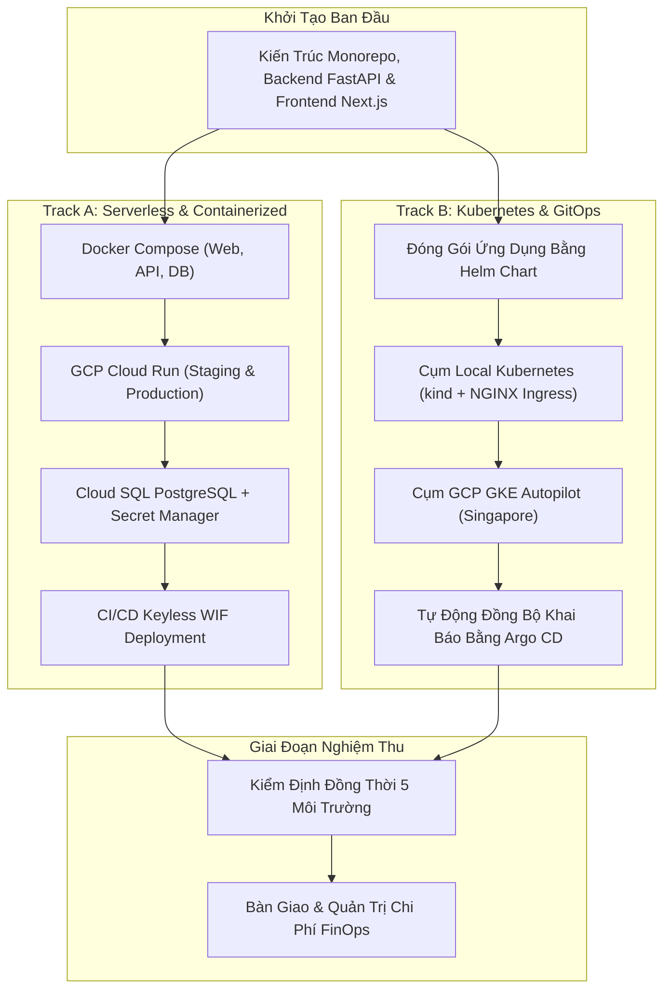

# Lộ Trình Triển Khai Kỹ Thuật Chi Tiết (Implementation Roadmap): DevSpeak AI

Tài liệu này chi tiết hóa các bước triển khai kỹ thuật từ khởi tạo hạ tầng, đóng gói ứng dụng, cấu hình GitOps đến nghiệm thu sản phẩm cuối cùng.

---

## 1. Lộ Trình Triển Khai Song Song 2 Lộ Trình (Track A & Track B)

---

## 2. Các Mốc Kỹ Thuật Đã Hoàn Thành

1. **Khởi tạo ngăn xếp Monorepo**: Xây dựng cấu trúc modular cho cả Web (Next.js 15) và API (FastAPI, Python 3.12, SQLAlchemy 2.0).
2. **Triển khai Track A**:
   - Khởi chạy thành công Docker Compose 3 container cục bộ.
   - Viết module Terraform cho Cloud Run, Cloud SQL, Secret Manager và Workload Identity Federation.
   - Triển khai và kiểm định trực tiếp Cloud Run Staging và Production tại Singapore (`asia-southeast1`).
3. **Triển khai Track B**:
   - Xây dựng Helm Chart tham số hóa hoàn chỉnh cho Web và API.
   - Khởi tạo cụm kind và kiểm tra thành công NGINX Ingress Controller.
   - Khởi tạo cụm GKE Autopilot và cấu hình Argo CD đồng bộ GitOps.
   - Khắc phục lỗi lặp tiền tố `/api/v1` và cập nhật bản vá v1.0.2-candidate lên kind Revision 2.
4. **Củng cố An toàn Thông tin & Vận hành**:
   - Thu hẹp quyền WIF Production chỉ cho phép nhánh `main`.
   - Chuyển đổi 5 script PowerShell sang đường dẫn tương đối động.
   - Chuyển ngữ toàn bộ hệ thống tài liệu kỹ thuật sang tiếng Việt.
