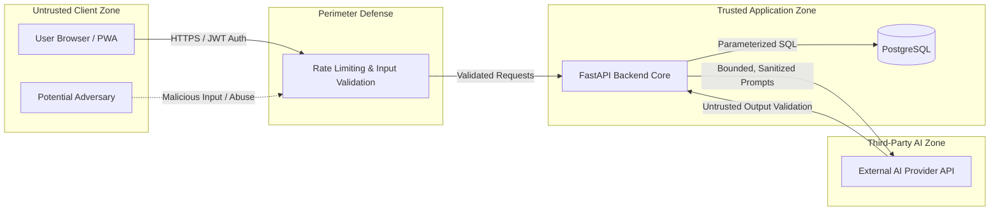

# Security Architecture & Threat Model: DevSpeak AI

## 1. Security Philosophy
Security and user privacy are primary non-negotiable requirements for DevSpeak AI. The application handles user answers, behavioral narratives, and potentially sensitive career information. We adopt a **secure-by-default, defense-in-depth, least-privilege** approach across the code, container, infrastructure, and AI integration layers.

---

## 2. Threat Modeling & Trust Boundaries

### Trust Boundaries:
1. **Client Boundary**: Any incoming payload from the browser is considered hostile until validated against explicit Pydantic schemas.
2. **AI Boundary**: Output from external LLM providers is considered untrusted data and must never be executed or directly injected into system commands or raw SQL.
3. **Database Boundary**: Direct SQL queries must use parameterized execution (SQLAlchemy ORM) to prevent SQL injection.
4. **Tenant Boundary**: All user sessions, turns, and feedback must be strictly partitioned by authenticated user identifier (`user_id`).

---

## 3. Threat Analysis & Mitigations (OWASP Top 10 + LLM Top 10)

| Threat Category | Specific Attack Vector | Mitigation Strategy | Status |
| :--- | :--- | :--- | :--- |
| **Prompt Injection** | User crafts input designed to override system prompt instructions or extract confidential system instructions. | 1. Candidate answer is isolated inside `<candidate_response>` XML blocks. 2. Explicit non-override and non-persona-adoption directives in system instructions. 3. Native Structured Outputs (`responseSchema`) enforce strictly typed JSON format, ignoring arbitrary output formats. 4. Output schema validation via Pydantic. | **Implemented & Verified** |
| **Denial of Wallet** | Malicious or high-frequency requests exhausting external LLM budget or compute. | 1. Max character length limit (4,000 chars) enforced at schema boundary. 2. Per-request timeouts (`AI_TIMEOUT_SECONDS=25`). 3. Bounded exponential backoff retries (`AI_MAX_RETRIES=2`). 4. `AI_PROVIDER=mock` available as offline zero-cost fallback. | **Implemented & Verified** |
| **Broken Access Control** | User attempting to view or tamper with another user's interview history or evaluation. | 1. Server-side session verification. 2. UUIDv4 identifiers used for all sessions, attempts, and messages. 3. Queries parameterized through SQLAlchemy ORM. 4. Multi-tenant user auth enforced with Argon2id and JWT bearer authentication. Sessions created by Candidate A cannot be viewed or modified by Candidate B (enforced with 403 Forbidden). | **Implemented & Verified** |
| **Sensitive Data Exposure** | Accidental leakage of user answers, audio, or API tokens in logs, git, or client bundles. | 1. Strict `.gitignore` preventing `.env` and `devspeak.db` commits. 2. Log sanitization filtering authorization headers and full answers (logs only `len(user_answer)`). 3. AI exceptions map to clean HTTP 429/502/503/504 responses without leaking stack traces or keys. 4. Zero storage of raw LLM credentials on frontend. | **Implemented & Verified** |
| **Vulnerable Dependencies** | Supply chain compromise via unvetted pip or npm packages. | 1. Direct REST client via `httpx` instead of bloated third-party SDKs. 2. Pinned dependency versions in `requirements.txt` and `package.json`. 3. Automated dependency audits planned in CI. | **Implemented & Verified** |

---

## 4. Secret Management Rules
- **No Hardcoded Secrets**: Secrets (API keys, database passwords, JWT secrets) are injected strictly through environment variables.
- **Local Isolation**: Local development uses `.env.example` templates; actual `.env` files are git-ignored.
- **Cloud Infrastructure**: Cloud deployments will utilize GitHub OIDC to assume temporary AWS IAM roles—no permanent AWS access keys will be stored in GitHub Secrets.

---

## 5. Candidate Authentication & Identity Security

1. **Argon2id Password Hashing**:
   - Implemented via `argon2-cffi` following the OWASP Password Storage Cheat Sheet.
   - Configuration parameters:
     - Memory cost: 65,536 KiB (64 MiB).
     - Time cost: 3 iterations.
     - Parallelism: 4 lanes.
     - Hash length: 32 bytes.
   - Provides industry-standard resistance against GPU/ASIC cracking and side-channel attacks.
2. **Stateless JWT Access Tokens**:
   - Signed using HS256 with server-side `JWT_SECRET_KEY`.
   - Access token lifetime: 1,440 minutes (24 hours).
   - Standard claims include subject (`sub: user_id`), issued-at (`iat`), and expiration (`exp`).
3. **Dual FastAPI Dependency Model**:
   - `get_current_user`: Strict authentication dependency requiring valid Bearer token. Unauthenticated or expired tokens return HTTP 401 with `WWW-Authenticate: Bearer`.
   - `get_optional_user`: Permissive authentication dependency returning `User` entity if token is valid, or `None` if absent or invalid. Enables seamless coexistence between anonymous guest sessions and isolated authenticated candidate workflows.
4. **Tenant Data Isolation**:
   - Registered candidate sessions are foreign-keyed to `users.id`.
   - All session retrieval and attempt creation endpoints verify `session.user_id == current_user.id` when `session.user_id` is set, rejecting unauthorized cross-tenant requests with HTTP 403 Forbidden.

---

## 6. Data Privacy & Retention

- **Minimal Collection**: We only collect the minimal information necessary for interview coaching (email and user-submitted answers).
- **Audio Privacy**: When speech capabilities are introduced (Milestone 6), audio will be processed in-flight for transcription and deleted immediately unless the user explicitly opts in to store recordings for review.
- **Provider Confidentiality**: API integrations will specify zero-data-retention or non-training agreements with commercial AI vendors wherever supported.
- **Local Persistence Boundary & Tenancy Notice**:
  - The local development database (`devspeak.db`) is intended for single-developer development and practice. It does not enforce multi-user authentication or authorization barriers.
  - Candidate answers, technical notes, and evaluation feedback stored locally are accessible to anyone with local disk access.
  - No claims of cryptographic tenant isolation are made until multi-user authentication and row-level ownership controls are implemented.
  - All database files (`*.db`, `*.sqlite`, `*-wal`, `*-shm`, `*.sql.gz`) are strictly ignored by `.gitignore` to prevent committing candidate practice transcripts into public or shared version control repositories.
  - Bounded pagination (`limit <= 100`) is enforced at the API boundary to prevent query-based resource exhaustion.
  - Server logging logs only the character length of submitted answers (`len(user_answer)`), avoiding dumping candidate responses into terminal logs or central aggregators.

---

## 6. DevSecOps CI Pipeline Hardening & Security Tooling

The automated CI workflow (`.github/workflows/ci.yml`) integrates continuous security testing gates:

1. **Least-Privilege Token Permissions**: The workflow sets `permissions: contents: read` globally, preventing GitHub Actions from writing to the repository or releasing artifacts without explicit scoped overrides.
2. **Commit SHA Action Pinning**: All GitHub Actions are pinned to exact 40-character commit SHAs (with version comments) to defend against supply chain attacks where a tagged action release is compromised.
3. **Secret Leak Detection (Gitleaks)**: Scans every commit and pull request to ensure credentials, private keys, or API tokens are never committed.
4. **Static Application Security Testing (SAST - Bandit)**:
   - Configured with `bandit -r src` on the FastAPI backend.
   - Verified 0 security findings across all application code. Resolved B110 by eliminating silent exception handling.
5. **Dependency Vulnerability Scanning (pip-audit & npm audit)**:
   - Python dependencies are audited against the PyPA vulnerability database via `pip-audit` during every CI run.
   - Frontend dependencies are verified via `npm audit` to track and mitigate known CVEs.
6. **Zero-Token Offline Test Isolation**:
   - The test suite executes strictly with `AI_PROVIDER: "mock"`.
   - CI runners do not require, store, or access live Google AI API keys or external networks during test execution.
