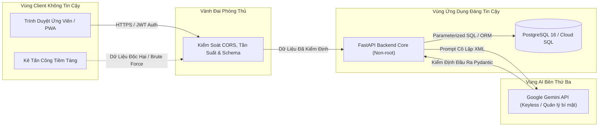

# Kiến Trúc An Toàn Thông Tin & Mô Hình Đe Dọa (Security Model): DevSpeak AI

## 1. Triết Lý Bảo Mật

Bảo mật và quyền riêng tư dữ liệu người dùng là ưu tiên kỹ thuật hàng đầu của DevSpeak AI. Nền tảng tiếp nhận các câu trả lời phỏng vấn, kinh nghiệm dự án và thông tin định hướng nghề nghiệp của ứng viên. Chúng tôi áp dụng nguyên tắc **Mặc định An toàn (Secure-by-Default), Phòng thủ Chiều sâu (Defense-in-Depth) và Đặc quyền Tối thiểu (Least-Privilege)** xuyên suốt từ mã nguồn, container, hệ thống hạ tầng Kubernetes/GCP đến tích hợp mô hình AI.

---

## 2. Mô Hình Đe Dọa & Ranh Giới Tin Cậy

### Ranh Giới Tin Cậy Cốt Lõi:
1. **Ranh Giới Client**: Mọi dữ liệu gửi lên từ trình duyệt đều bị coi là nguy hiểm cho đến khi được xác thực chặt chẽ qua schema Pydantic.
2. **Ranh Giới AI (Third-party LLM)**: Dữ liệu trả về từ LLM được xem là không tin cậy, bắt buộc phải thẩm định cấu trúc JSON và schema trước khi lưu vào CSDL hoặc hiển thị.
3. **Ranh Giới Cơ Sở Dữ Liệu**: Tuyệt đối không dùng câu lệnh SQL ghép chuỗi, bắt buộc sử dụng truy vấn tham số hóa (Parameterized Queries) qua SQLAlchemy ORM.
4. **Ranh Giới Ứng Viên (Tenant Isolation)**: Mọi dữ liệu phiên học, câu trả lời và báo cáo đánh giá đều được phân vùng nghiêm ngặt theo `user_id`.

---

## 3. Phân Tích Nguy Cơ & Chiến Lược Phòng Thủ (OWASP Top 10 + LLM Top 10)

| Nhóm nguy cơ | Kịch bản tấn công | Chiến lược phòng ngự | Hiện trạng |
| :--- | :--- | :--- | :--- |
| **Tiêm Lệnh AI (Prompt Injection)** | Người dùng chèn câu lệnh nhằm ghi đè System Prompt hoặc đánh cắp dữ liệu chấm điểm nội bộ. | 1. Đặt câu trả lời trong thẻ XML `<candidate_response>`. 2. Chỉ dẫn rõ ràng cấm thực thi lệnh trong nội dung người dùng. 3. Ép kiểu JSON nguyên bản qua `responseSchema`. 4. Xác thực dữ liệu đầu ra qua Pydantic. | 🟢 **Đã triển khai & kiểm định** |
| **Tấn Công Cạn Kiệt Tài Chính (Denial of Wallet)** | Gửi yêu cầu tần suất cao hoặc câu trả lời dung lượng lớn nhằm làm cạn kiệt ngân sách AI API. | 1. Giới hạn độ dài câu trả lời tối đa 4.000 ký tự. 2. Thiết lập thời gian timeout nghiêm ngặt (`AI_TIMEOUT_SECONDS=25`). 3. Giới hạn số lần thử lại tối đa 2 lần với thuật toán giãn cách. 4. Chế độ Mock nội bộ chi phí 0đ luôn sẵn sàng hoạt động. | 🟢 **Đã triển khai & kiểm định** |
| **Lỗ Hổng Phân Quyền (Broken Access Control)** | Người dùng A cố ý xem hoặc can thiệp vào phiên phỏng vấn của người dùng B. | 1. Kiểm tra quyền sở hữu phiên ở tầng backend. 2. Sử dụng định danh ngẫu nhiên UUIDv4 khó đoán. 3. Xác thực Bearer Token JWT kết hợp mã băm Argon2id. 4. Chặn đứng hành vi truy cập chéo bằng mã lỗi HTTP 403 Forbidden. | 🟢 **Đã triển khai & kiểm định** |
| **Lộ Lọt Dữ Liệu Nhạy Cảm (Data Exposure)** | Vô tình lộ khóa bí mật, API key, token hoặc câu trả lời trong log hệ thống, Git hoặc bundle JS. | 1. Cấu hình `.gitignore` nghiêm ngặt loại trừ `.env*`, `*.db`. 2. Bộ lọc log chỉ ghi độ dài chuỗi (`len(user_answer)`), không in nội dung nhạy cảm. 3. Tự động che giấu chi tiết lỗi nội bộ (HTTP 429/502/503/504). 4. Toàn bộ API key lưu tại Google Secret Manager, không đưa xuống Frontend. | 🟢 **Đã triển khai & kiểm định** |
| **Lỗ Hổng Chuỗi Cung Ứng (Supply Chain)** | Các gói thư viện phụ thuộc của Python hoặc npm bị cài cắm mã độc. | 1. Sử dụng trực tiếp `httpx` thay vì các SDK cồng kềnh. 2. Cố định phiên bản phụ thuộc trong `requirements.txt` và `package-lock.json`. 3. Tự động quét kiểm tra lỗ hổng qua `pip-audit`, `npm audit` và `Trivy`. | 🟢 **Đã triển khai & kiểm định** |

---

## 4. Quản Lý Bí Mật & Kiểm Soát Danh Tính (Secret Management & IAM)

1. **Tuyệt Đối Không Lưu Bí Mật Trong Mã Nguồn**: Mọi khóa bí mật, mật khẩu cơ sở dữ liệu và khóa mã hóa JWT đều được nạp thông qua biến môi trường hoặc Secret Manager.
2. **Xác Thực Không Dùng Khóa Tĩnh (Keyless WIF trên GCP)**:
   - GitHub Actions kết nối tới Google Cloud Platform hoàn toàn thông qua **Workload Identity Federation (WIF)**.
   - Không tồn tại Service Account JSON Key có thể bị đánh cắp.
   - **Ràng Buộc Nghiêm Ngặt Phân Nhánh**: Quyền triển khai production (`roles/iam.workloadIdentityUser`) được giới hạn chính xác chỉ cho nhánh `refs/heads/main` của repository `nguyenlpn2015/DevSpeak-AI`.
3. **Mã Hóa Mật Khẩu Chuẩn Argon2id**:
   - Sử dụng thư viện `argon2-cffi` tuân thủ khuyến nghị của OWASP Cheat Sheet.
   - Tham số kỹ thuật: Bộ nhớ 64 MiB, 3 vòng lặp, 4 luồng song song, độ dài mã băm 32 bytes chống tấn công bằng phần cứng GPU/ASIC chuyên dụng.
4. **Token Truy Cập JWT Bất Đối Xứng / Không Trạng Thái**:
   - Ký bằng thuật toán HMAC-SHA256 (`HS256`) với khóa bí mật dài từ server.
   - Thời hạn hiệu lực: 24 giờ (1.440 phút).

---

## 5. Bảo Vệ Dữ Liệu Riêng Tư & Lưu Trữ Tối Thiểu

- **Thu Thập Tối Thiểu (Data Minimization)**: Chỉ thu thập các trường thông tin cần thiết phục vụ việc luyện phỏng vấn (email và nội dung câu trả lời).
- **Quyền Riêng Tư Về Giọng Nói**: Bản ghi âm từ trình duyệt chỉ được chuyển đổi thành văn bản tại chỗ qua Web Speech API và không lưu trữ trên máy chủ trừ khi có sự chấp thuận chủ động của ứng viên.
- **Cam Kết Từ Chối Đào Tạo (Zero Data Retention)**: Tích hợp AI thương mại tuân thủ chính sách không sử dụng dữ liệu khách hàng để huấn luyện lại mô hình công cộng.
- **Cách Ly Container Cấp Phép Thấp (Non-Root Execution)**:
  - Docker container của Backend chạy dưới người dùng hệ thống `appuser` (UID 10001).
  - Docker container của Frontend chạy dưới người dùng hệ thống `nextjs` (UID 1001).
  - Thiết lập cờ `no-new-privileges: true` và `readOnlyRootFilesystem` khi triển khai production.
