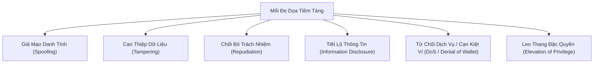

# Mô Hình Đe Dọa An Ninh Thông Tin (Threat Model): DevSpeak AI

**Phiên bản**: 1.0.1  
**Mục tiêu**: Phân tích toàn diện các mối đe dọa an ninh thông tin theo mô hình STRIDE và chuẩn OWASP Top 10 API / LLM.

---

## 1. Phương Pháp Luận Phân Tích Đe Dọa (Methodology)

DevSpeak AI áp dụng mô hình phân loại **STRIDE** (Spoofing, Tampering, Repudiation, Information Disclosure, Denial of Service, Elevation of Privilege) kết hợp tiêu chuẩn **OWASP Top 10 for LLM Applications**:

---

## 2. Bảng Phân Tích Đe Dọa Chi Tiết Theo Mô Hình STRIDE

| Danh mục STRIDE | Mối đe dọa cụ thể | Biện pháp giảm thiểu | Trạng thái xác thực |
| :--- | :--- | :--- | :--- |
| **Giả mạo (Spoofing)** | Kẻ tấn công giả mạo token JWT của ứng viên khác hoặc giả mạo GitHub Actions OIDC để truy cập GCP. | 1. Token JWT ký bằng HMAC-SHA256 với khóa bí mật dài quản lý bởi Secret Manager. 2. Workload Identity Federation (WIF) chỉ chấp nhận OIDC token từ nhánh `main` của repository chính thức. | 🟢 **Đã xác thực & củng cố** |
| **Can thiệp (Tampering)** | Kẻ tấn công can thiệp vào câu trả lời phỏng vấn hoặc tiêm mã độc vào Prompt AI (Prompt Injection). | 1. Cô lập câu trả lời ứng viên trong thẻ XML `<candidate_response>`. 2. Ràng buộc JSON Schema bắt buộc bằng `responseSchema`. 3. Kiểm soát dữ liệu đầu vào không vượt quá 4.000 ký tự. | 🟢 **Đã xác thực** |
| **Chối bỏ (Repudiation)** | Ứng viên hoặc người dùng phủ nhận đã thực hiện lượt phỏng vấn hoặc hành động trên hệ thống. | 1. Lưu trữ nhật ký giao dịch kèm mốc thời gian UTC chính xác trong PostgreSQL. 2. Ghi log có cấu trúc (Structured JSON logging) lên Google Cloud Logging với Request ID duy nhất. | 🟢 **Đã xác thực** |
| **Tiết lộ thông tin (Information Disclosure)** | Lộ khóa bí mật, API key, mật khẩu CSDL hoặc câu trả lời của ứng viên khác qua log hoặc Git. | 1. Quy chuẩn `.gitignore` loại trừ hoàn toàn các file bí mật. 2. Bộ lọc log chỉ ghi độ dài ký tự câu trả lời (`len(user_answer)`). 3. Đóng cổng Swagger UI (`/docs`, `/redoc`) trên môi trường Production (HTTP 404). | 🟢 **Đã xác thực** |
| **Từ chối dịch vụ (Denial of Service / Wallet)** | Tấn công gửi liên tục câu trả lời dài để làm cạn kiệt ngân sách Google Gemini API hoặc treo cụm server. | 1. Giới hạn độ dài câu trả lời tối đa 4.000 ký tự. 2. Giới hạn thời gian timeout AI là 25 giây. 3. Mặc định kích hoạt AI Mock 0 chi phí cho môi trường công cộng. | 🟢 **Đã xác thực** |
| **Leo thang đặc quyền (Elevation of Privilege)** | Tài khoản ứng viên thông thường cố gắng chiếm quyền quản trị hệ thống hoặc truy cập phiên người khác. | 1. Phân quyền chặt chẽ theo `user_id` ở tầng Service Layer. 2. Trả về mã lỗi HTTP 403 Forbidden đối với mọi hành vi truy cập chéo tài khoản. 3. Container thực thi dưới người dùng phi đặc quyền (non-root). | 🟢 **Đã xác thực** |

---

## 3. Quản Trị Khóa Bí Mật & Danh Tính Đám Mây

- **Zero-Key Architecture**: Tuyệt đối không tạo file Service Account JSON Key tĩnh. Mọi phiên CI/CD từ GitHub Actions đều xác thực qua Workload Identity Federation (WIF) với thời hạn token chỉ vài phút.
- **Ràng buộc phân nhánh**: Service Account Deployer chỉ được phép kích hoạt từ `repo:nguyenlpn2015/DevSpeak-AI:ref:refs/heads/main`.
